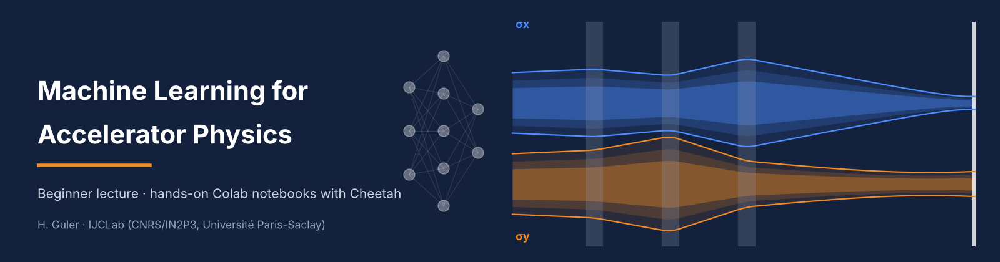
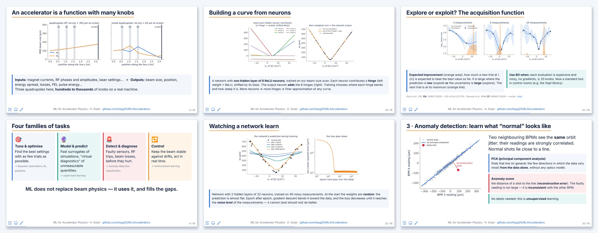

<p align="center">
  
</p>

<p align="center">
  <a href="https://hayg25.github.io/ML4Accelerators/"></a>
  <a href="https://hayg25.github.io/ML4Accelerators/slides/ml4acc.html"></a>
  <a href="https://colab.research.google.com/github/hayg25/ML4Accelerators/blob/main/notebooks/00_cheetah_basics.ipynb"></a>
  <a href="https://github.com/hayg25/ML4Accelerators/actions/workflows/publish.yml"></a>
  <a href="https://github.com/hayg25/ML4Accelerators/actions/workflows/test-notebooks.yml"></a>
  <br>
  
  <a href="https://github.com/desy-ml/cheetah"></a>
  <a href="LICENSE"></a>
  <a href="LICENSE-CONTENT.md"></a>
</p>

<p align="center">
  <b><a href="https://hayg25.github.io/ML4Accelerators/slides/ml4acc.html">Slides</a></b> ·
  <b><a href="https://hayg25.github.io/ML4Accelerators/">Website</a></b> ·
  <b><a href="#hands-on-notebooks">Notebooks</a></b> ·
  <b><a href="https://hayg25.github.io/ML4Accelerators/nuclear.html">Nuclear track</a></b> ·
  <b><a href="notebooks/solutions/">Solutions</a></b> ·
  <b><a href="#citation">Cite</a></b>
</p>

---

An **introductory lecture (≈ 1 h) on machine-learning methods for particle accelerators**, for
students and young researchers with **no prior ML background**, followed by **four hands-on
notebooks** that run in the browser on Google Colab — no installation required.

Every concept is built on the **same physical example**, a three-quadrupole electron transport
line simulated with the differentiable beam-dynamics code
[Cheetah](https://github.com/desy-ml/cheetah): students first meet a neural network fitting
the beam size versus one quadrupole strength, then use the very same beamline to build a
surrogate model, run Bayesian optimisation and detect faulty beam position monitors.
A second set of notebooks applies the same methods to **nuclear-energy** problems
(radionuclide identification, reactor-physics surrogate, neutron/gamma discrimination).

<p align="center">
  <a href="https://hayg25.github.io/ML4Accelerators/slides/ml4acc.html">
    
  </a>
</p>

## Learning outcomes

After the lecture and the exercises, participants can

- explain supervised, unsupervised and reinforcement learning with accelerator examples;
- describe how a neural network is built (neuron, activation, layers) and trained (loss, gradient descent, backpropagation);
- recognise overfitting and evaluate a model honestly on a held-out test set;
- choose between a surrogate model, Bayesian optimisation, anomaly detection, reinforcement learning or a differentiable simulation for a given accelerator task;
- implement each of these methods on a simulated beamline in a few dozen lines of Python.

## Lecture content

| Part | Topics |
|:--|:--|
| **1 · Why ML for accelerators?** | many coupled knobs, noisy diagnostics, drifts, expensive simulations · four families of tasks: tune, model, detect, control |
| **2 · Machine learning from scratch** | dataset, model, loss, optimiser · gradient descent and learning rate · neural networks step by step: the neuron, activation functions, building a curve from ReLU "hinges", layers, backpropagation · overfitting, train / validation / test |
| **3 · A tour of the methods** | surrogate models & virtual diagnostics · Bayesian optimisation (Gaussian processes, acquisition functions) · anomaly detection (PCA, Isolation Forest) and fault classification · reinforcement learning · differentiable simulations and physics-informed ML |
| **4 · Good practice** | baselines, data representation, uncertainty, drifts, safety in the control room |

Each method is illustrated with a published application (LCLS, LHC, CEBAF, AWAKE, ARES…);
references are listed at the end of the slides.

## Hands-on notebooks

### Accelerator track

| # | Notebook | You will learn | Exercise | Solution |
|:-:|:--|:--|:-:|:-:|
| 0 | **First beamline with Cheetah** | build and track a beamline · manual tuning · gradient-based tuning through a differentiable simulator · local minima | [](https://colab.research.google.com/github/hayg25/ML4Accelerators/blob/main/notebooks/00_cheetah_basics.ipynb) | [](https://colab.research.google.com/github/hayg25/ML4Accelerators/blob/main/notebooks/solutions/00_cheetah_basics.ipynb) |
| 1 | **Neural-network surrogate** | dataset generation · linear baseline vs. MLP · test set · learning curve · extrapolation | [](https://colab.research.google.com/github/hayg25/ML4Accelerators/blob/main/notebooks/01_surrogate_model.ipynb) | [](https://colab.research.google.com/github/hayg25/ML4Accelerators/blob/main/notebooks/solutions/01_surrogate_model.ipynb) |
| 2 | **Bayesian optimisation** | Gaussian processes · expected improvement · coding the BO loop · comparison with random search · noise | [](https://colab.research.google.com/github/hayg25/ML4Accelerators/blob/main/notebooks/02_bayesian_optimisation.ipynb) | [](https://colab.research.google.com/github/hayg25/ML4Accelerators/blob/main/notebooks/solutions/02_bayesian_optimisation.ipynb) |
| 3 | **Faulty BPM detection** | unsupervised learning · PCA reconstruction error · Isolation Forest · precision vs. recall | [](https://colab.research.google.com/github/hayg25/ML4Accelerators/blob/main/notebooks/03_anomaly_detection.ipynb) | [](https://colab.research.google.com/github/hayg25/ML4Accelerators/blob/main/notebooks/solutions/03_anomaly_detection.ipynb) |

### Nuclear-energy track

The same methods applied to problems of reactor physics, radiation protection and dosimetry —
each notebook contains its own small physics simulator, **nothing to install**. Context, typical
applications and references: [ML for nuclear energy](https://hayg25.github.io/ML4Accelerators/nuclear.html).

| # | Notebook | You will learn | Exercise | Solution |
|:-:|:--|:--|:-:|:-:|
| 4 | **Radionuclide identification** | simulated NaI spectra · ROI vs. neural network vs. full-spectrum fit · counting statistics · gain drift & augmentation · unknown nuclides | [](https://colab.research.google.com/github/hayg25/ML4Accelerators/blob/main/notebooks/04_gamma_spectroscopy.ipynb) | [](https://colab.research.google.com/github/hayg25/ML4Accelerators/blob/main/notebooks/solutions/04_gamma_spectroscopy.ipynb) |
| 5 | **Reactor-physics surrogate** | Latin-hypercube design · Gaussian process with uncertainty · critical boron search · uncertainty propagation · GP vs. NN with 40 runs | [](https://colab.research.google.com/github/hayg25/ML4Accelerators/blob/main/notebooks/05_reactor_surrogate.ipynb) | [](https://colab.research.google.com/github/hayg25/ML4Accelerators/blob/main/notebooks/solutions/05_reactor_surrogate.ipynb) |
| 6 | **Neutron/gamma PSD** | pulse simulation · optimised charge comparison vs. neural network · pile-up · gamma rejection at the operating point | [](https://colab.research.google.com/github/hayg25/ML4Accelerators/blob/main/notebooks/06_neutron_gamma_psd.ipynb) | [](https://colab.research.google.com/github/hayg25/ML4Accelerators/blob/main/notebooks/solutions/06_neutron_gamma_psd.ipynb) |

Each notebook is self-contained (30–60 min). Cells marked ✏️ are left for the participants
(`...` / `# TODO`); the solution notebooks are complete.

## Getting started

**In the browser (recommended for students)** — click an *Open in Colab* badge above, then
*Runtime → Run all*. The first cell installs Cheetah (~30 s). Use *File → Save a copy in Drive*
to keep your work.

**Locally**

```bash
git clone https://github.com/hayg25/ML4Accelerators.git
cd ML4Accelerators
python -m venv .venv && source .venv/bin/activate
pip install -r requirements.txt
jupyter lab notebooks/
```

**Slides and website** — requires [Quarto](https://quarto.org) ≥ 1.4:

```bash
quarto preview                      # whole website, live reload
quarto preview slides/ml4acc.qmd    # slides only
```

## Repository structure

```
ML4Accelerators/
├── slides/
│   ├── ml4acc.qmd               # the lecture (Quarto reveal.js)
│   └── theme.scss               # slide theme
├── notebooks/
│   ├── src/*.py                 # single source of every notebook (edit these)
│   ├── 0x_*.ipynb               # exercise versions   (generated)
│   └── solutions/0x_*.ipynb     # solution versions   (generated)
├── scripts/
│   ├── build_notebooks.py       # src/*.py → exercise + solution notebooks
│   ├── make_figures.py          # all slide figures (numpy / scikit-learn / matplotlib)
│   └── optics.py                # minimal linear-optics model used for the figures
├── assets/                      # figures and README images
├── index.qmd, exercises.qmd,    # website pages
│   nuclear.qmd
└── .github/workflows/           # publish website · execute notebooks with Cheetah
```

## Maintaining the material

- **Notebooks** are generated from `notebooks/src/*.py`. Code between `### BEGIN SOLUTION`
  and `### END SOLUTION` appears only in the solutions; lines `### EXERCISE: …` only in the
  exercise version. After editing a source, run `python scripts/build_notebooks.py`.
- **Figures** are reproducible: `python scripts/make_figures.py` regenerates every slide figure.
- **Continuous integration**: every push renders and deploys the website, and executes all
  solution notebooks with the current Cheetah release, so API changes are caught early.

## Citation

If you use or adapt this material, please cite it (GitHub's *Cite this repository* button
reads [`CITATION.cff`](CITATION.cff)):

```bibtex
@misc{guler_ml4accelerators,
  author       = {Guler, Hayg},
  title        = {{Machine Learning for Accelerator Physics: a beginner's lecture with hands-on notebooks}},
  year         = {2026},
  howpublished = {\url{https://github.com/hayg25/ML4Accelerators}},
  note         = {IJCLab (CNRS/IN2P3, Universit\'e Paris-Saclay)}
}
```

## Acknowledgements

The exercises rely on [Cheetah](https://github.com/desy-ml/cheetah)
(J. Kaiser, C. Xu, A. Eichler, A. Santamaria Garcia *et al.*, PRAB **27**, 054601, 2024) and on
[scikit-learn](https://scikit-learn.org) and [PyTorch](https://pytorch.org). Slides are built
with [Quarto](https://quarto.org).

## License

- Code (notebooks, scripts): [MIT](LICENSE)
- Slides, text and figures: [CC BY 4.0](LICENSE-CONTENT.md)

<p align="center"><sub>Hayg Guler · IJCLab (CNRS/IN2P3, Université Paris-Saclay)</sub></p>
