## Today's plan

:::: {.columns}
::: {.column width="56%"}

1. **Why machine learning for accelerators?**
2. **Machine learning from scratch**
   - model, loss, training
   - neural networks, step by step
   - overfitting and test sets
3. **A tour of the methods**
   - surrogate models · Bayesian optimisation
   - anomaly detection · reinforcement learning
   - differentiable simulations
4. **Good practice & take-home messages**

:::
::: {.column width="44%"}

::: {.box-orange}
<span class="box-title">Hands-on afterwards</span>
4 notebooks, run in your browser on **Google Colab**, using the
differentiable beam-dynamics code **Cheetah**. No installation needed.
:::

::: {.box}
<span class="box-title">Prerequisites</span>
Basic Python. Basic beam optics (drift, quadrupole, beam size).
**No** prior machine-learning knowledge.
:::

::: {.box-teal}
<span class="box-title">One running example</span>
All along, we use the same small beamline: three quadrupoles and a screen.
:::

:::
::::

::: notes
The lecture is a map, not a deep dive. Part 2 builds the vocabulary slowly, using a single
physical example (beam size vs. quadrupole strength), so that the methods of part 3 can be
explained with the same words.
:::

# Why machine learning for accelerators? {background-color="#14213d" .section-slide}

## An accelerator is a function with many knobs

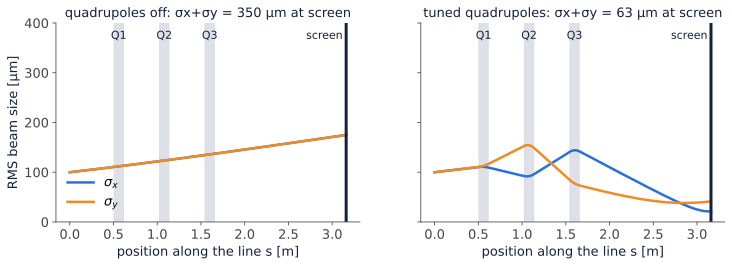{height="330px" fig-align="center"}

::: {.box}
**Inputs:** magnet currents, RF phases and amplitudes, laser settings… &nbsp;→&nbsp;
**Outputs:** beam size, position, energy spread, losses, FEL pulse energy…
<br>Three quadrupoles here; **hundreds to thousands** of knobs on a real machine.
:::

::: notes
This is the toy beamline used in all exercises: 3 quadrupoles and a screen.
Left: quadrupoles off, the beam just grows. Right: tuned, the beam is focused on the screen.
Finding the good settings is an optimisation problem. With 3 knobs you can do it by hand
(exercise 0); with 300 you cannot.
:::

## What makes it hard?

::: {.cards-3}
::: {.box}
<span class="icon">🎛️</span>
<span class="box-title">Many coupled parameters</span>
Changing one magnet changes the optimum of all the others.
:::
::: {.box-orange}
<span class="icon">📉</span>
<span class="box-title">Noisy, partial diagnostics</span>
Shot-to-shot jitter; many quantities cannot be measured without destroying the beam.
:::
::: {.box-teal}
<span class="icon">🌡️</span>
<span class="box-title">Drifts</span>
Temperature, ageing, hysteresis: yesterday's optimum is not today's.
:::
::: {.box-navy}
<span class="icon">🖥️</span>
<span class="box-title">Expensive simulations</span>
Space charge, CSR, wakefields: minutes to hours per run.
:::
::: {.box-red}
<span class="icon">⏱️</span>
<span class="box-title">Precious beam time</span>
Every tuning minute is taken from the users.
:::
::: {.box}
<span class="icon">🗄️</span>
<span class="box-title">…but lots of data</span>
Archived signals from thousands of sensors, every second.
:::
:::

::: notes
These are exactly the situations where ML helps: learn from data what is too complex to
model by hand, use few evaluations, adapt to drifts.
:::

## Four families of tasks

::: {.cards-4}
::: {.box}
<span class="icon">🎯</span>
<span class="box-title">Tune & optimise</span>
Find the best settings with as few trials as possible.
<br><span class="muted small">→ Bayesian optimisation, RL, gradients</span>
:::
::: {.box-teal}
<span class="icon">🔮</span>
<span class="box-title">Model & predict</span>
Fast surrogates of simulations; "virtual diagnostics" of unmeasurable quantities.
<br><span class="muted small">→ supervised learning</span>
:::
::: {.box-red}
<span class="icon">🚨</span>
<span class="box-title">Detect & diagnose</span>
Faulty sensors, RF trips, beam losses, before they hurt.
<br><span class="muted small">→ anomaly detection, classification</span>
:::
::: {.box-orange}
<span class="icon">🔁</span>
<span class="box-title">Control</span>
Keep the beam stable against drifts, act in real time.
<br><span class="muted small">→ reinforcement learning</span>
:::
:::

::: {.big-quote}
ML does not replace beam physics — it **uses** it, and fills the gaps.
:::

::: notes
This is the map for the rest of the talk. Each method we will see belongs mostly to one
of these families. Good overview: Edelen et al., "Opportunities in machine learning for
particle accelerators", arXiv:1811.03172 (2018).
:::

# Machine learning from scratch {background-color="#14213d" .section-slide}

## From writing rules to learning them

:::: {.columns}
::: {.column width="48%"}
::: {.box-navy}
<span class="box-title">Classical approach</span>
A human writes the **rules** (physics model, thresholds); the computer applies them to data.
<br><span class="small muted">e.g. "flag a BPM if |x| > 2 mm"</span>
:::
:::
::: {.column width="4%"}
:::
::: {.column width="48%"}
::: {.box-orange}
<span class="box-title">Machine learning</span>
The computer **finds the rules** from examples (or from a goal). The result is called a **model**.
<br><span class="small muted">e.g. "learn what normal BPM data look like"</span>
:::
:::
::::

::: {.big-quote}
A program **learns** when its performance on a task, measured by some metric,
improves with experience (= data).
:::
<div class="center small muted">— paraphrasing T. Mitchell, <em>Machine Learning</em> (1997)</div>

::: notes
ML is useful when the rules are too complex to write down, or unknown, but examples exist.
Keep the three words: task, performance metric, experience. We will find them in every method.
:::

## Three ways to learn

::: {.cards-3}
::: {.box}
<span class="box-title">Supervised</span>
Examples **with the right answer**: (input, output) pairs. Learn the mapping input → output.
<br><br>**Accelerator example:** magnet settings → beam size; RF signals → fault type.
:::
::: {.box-teal}
<span class="box-title">Unsupervised</span>
Data **without** answers. Find structure: groups, low-dimensional patterns, outliers.
<br><br>**Accelerator example:** spot faulty BPMs in logged data.
:::
::: {.box-orange}
<span class="box-title">Reinforcement</span>
An agent **acts**, receives a **reward**, and improves its strategy by trial and error.
<br><br>**Accelerator example:** learn to focus the beam by moving magnets.
:::
:::

::: {.center .small .muted}
We start with **supervised** learning: it contains all the key ideas.
:::

## Our running example: a dataset

:::: {.columns}
::: {.column width="45%"}

We scan quadrupole **Q1** and record the beam size **σx** on the screen — 25 measurements.

| sample | input $x$<br>$k_1$ of Q1 [1/m²] | target $y$<br>σx [µm] |
|:-:|:-:|:-:|
| 1 | −11.8 | 527 |
| 2 | 2.2 | 104 |
| 3 | 9.4 | 148 |
| 4 | 21.1 | 513 |
| … | … | … |
| 25 | 24.4 | 615 |

:::
::: {.column width="55%"}

::: {.box .fragment}
<span class="box-title">Vocabulary</span>
One row = a **sample**. The quantity we know = the **input** (or *feature*). The quantity we
want to predict = the **target** (or *label*). All rows = the **dataset**.
:::

::: {.box-orange .fragment}
<span class="box-title">The question</span>
Can the computer learn the relation $y = f(x)$ **from these 25 rows alone**,
without being told the beam-optics formula?
:::

::: {.box-teal .fragment}
<span class="box-title">Why bother, here?</span>
Here we know the physics. But with 300 magnets, space charge and imperfections, we often don't — the same recipe still works.
:::

:::
::::

::: notes
The data are simulated with the exercise beamline (Q2 = Q3 = 0) plus 6 % measurement noise.
Real inputs usually have many columns (all magnet settings), and outputs too.
:::

## The four ingredients of (almost) every ML method

:::: {.columns}
::: {.column width="55%"}

1. **Data** — the samples $(x_i, y_i)$
2. **Model** — a function with adjustable parameters $\theta$: $\hat y = f_\theta(x)$
   <br><span class="small muted">a straight line has 2 parameters: $\hat y = \theta_1 x + \theta_0$</span>
3. **Loss** — one number saying how wrong the model is on the data
4. **Optimiser** — a procedure that changes $\theta$ to make the loss smaller

:::
::: {.column width="45%"}
::: {.box-teal}
<span class="box-title">Physicist's translation</span>
This is **fitting**! A least-squares fit of a line is already machine learning.
:::
::: {.box-orange .fragment}
<span class="box-title">What is new?</span>
Models that are much more **flexible** (thousands of parameters), and a strong focus on
predicting **new** data correctly.
:::
:::
::::

::: notes
Demystify: everything in this lecture is a variation on data / model / loss / optimiser.
In Bayesian optimisation the model is a Gaussian process; in RL the "model" is the policy and
the loss is minus the reward; in PCA the loss is the reconstruction error. Same skeleton.
:::

## Measuring how wrong a model is: the loss

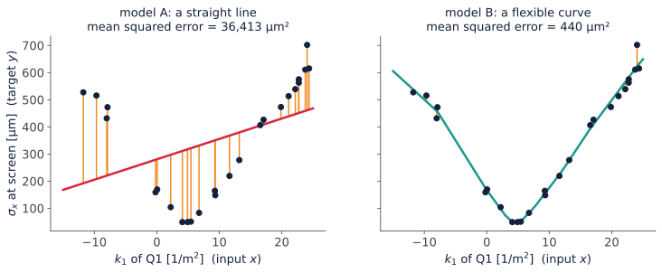{height="330px" fig-align="center"}

:::: {.columns}
::: {.column width="55%"}
For each sample, the **residual** (orange) is the gap between data and model.
The **mean squared error** averages the squared residuals:
$$
L(\theta) = \frac{1}{N}\sum_{i=1}^{N} \left(f_\theta(x_i) - y_i\right)^2
$$
:::
::: {.column width="45%"}
::: {.box .small}
Squaring makes every error positive and penalises big errors strongly.
**Training = finding the parameters θ with the smallest loss.**
A straight line cannot do better than model A: we need a more **flexible** model.
:::
:::
::::

::: notes
Model B is a small neural network trained on the same 25 points. Loss 36 000 µm² vs 440 µm²,
i.e. typical errors of ~190 µm vs ~20 µm (square root).
:::

## Training = walking downhill on the loss

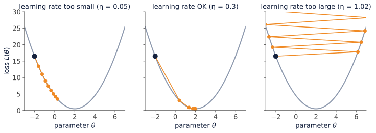{height="300px" fig-align="center"}

:::: {.columns}
::: {.column width="50%"}
**Gradient descent**, repeated many times:

1. compute the **slope** of the loss, $\partial L/\partial\theta$
2. take a small step **downhill**: $\theta \leftarrow \theta - \eta\,\dfrac{\partial L}{\partial\theta}$
:::
::: {.column width="50%"}
::: {.box-orange .small}
<span class="box-title">The learning rate η</span>
The step size. Too small: very slow. Too large: the steps overshoot and the training diverges.
It is the first knob to adjust when training does not work.
:::
:::
::::

::: notes
Like a hiker in fog who only feels the slope under their feet. With thousands of parameters,
the "slope" is a vector — the gradient — but the idea is identical.
:::

## The same idea in two (or 10 000) dimensions

:::: {.columns}
::: {.column width="48%"}
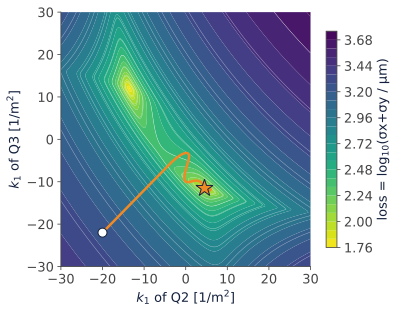{width="100%"}
:::
::: {.column width="52%"}
Here the two parameters are **quadrupole strengths** and the "loss" is the beam size at the
screen (Q1 fixed). Colours = height of the landscape.

::: {.box .small}
The orange path is gradient descent (Adam variant) starting from the white dot:
it follows the valley to a minimum ★.
:::
::: {.box-red .small}
Gradient descent is **local**: it finds the bottom of the valley it starts in, not
necessarily the deepest one. You will see this in exercise 0.
:::
::: {.box-teal .small}
Training a neural network = exactly this, with thousands of parameters (the weights).
:::
:::
::::

## Neural networks, step by step {background-color="#14213d" .section-slide}

## Why do we need neural networks?

::: {.cards-3}
::: {.box}
<span class="box-title">1 · We rarely know the formula</span>
For a real machine (errors, space charge, many coupled knobs), nobody can write $y=f(x)$ by hand.
:::
::: {.box-orange .fragment}
<span class="box-title">2 · Classical fits do not scale</span>
A polynomial in 1 variable is easy. In 100 variables, the number of terms explodes.
:::
::: {.box-teal .fragment}
<span class="box-title">3 · We want a universal "Lego"</span>
One simple building block, repeated and combined, able to approximate **any** smooth function.
:::
:::

::: {.fragment}
::: {.big-quote}
A neural network is that Lego: many copies of one very simple brick — the **neuron** —
whose parameters are found by gradient descent.
:::
:::

::: notes
Insist: there is nothing biological or mysterious here. It is a big parametrised function.
The name comes from a loose analogy with brain cells (McCulloch & Pitts, 1943).
:::

## The brick: one artificial neuron

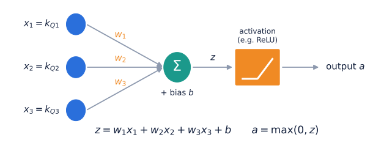{height="250px" fig-align="center"}

:::: {.columns}
::: {.column width="50%"}
1. multiply each input by a **weight** $w_j$ (how much it matters, and with which sign)
2. add them up, plus a **bias** $b$ (an offset)
3. pass the result through an **activation function**, here ReLU: keep $z$ if positive, else 0
:::
::: {.column width="50%"}
::: {.box-orange .small .fragment}
<span class="box-title">Worked example</span>
inputs $k = (5,\,-13,\,12)$, weights $w = (0.2,\,-0.1,\,0.05)$, bias $b = 0.5$
<br>$z = 0.2\cdot5 + (-0.1)(-13) + 0.05\cdot12 + 0.5$
<br>$\phantom{z} = 1.0 + 1.3 + 0.6 + 0.5 = 3.4$
<br>$a = \max(0,\,3.4) = 3.4$
:::
::: {.box-navy .small .fragment}
Another neuron with $w = (-0.3,\,0.1,\,0)$, $b = 0.2$ gives $z = -2.6$, so $a = 0$:
this neuron is "off" for this input.
:::
:::
::::

::: notes
The weights and bias are the adjustable parameters. A neuron alone is a very poor model:
it is a straight line with a kink. The power comes from combining many of them.
:::

## Why an activation function?

{height="230px" fig-align="center"}

:::: {.columns}
::: {.column width="50%"}
::: {.box-red .small}
<span class="box-title">Without activation</span>
Each neuron is a weighted sum = a **linear** function. Combining linear functions only gives
another linear function: the whole network would be a straight line (model A!).
:::
:::
::: {.column width="50%"}
::: {.box-teal .small}
<span class="box-title">With activation</span>
The small non-linearity (a kink for ReLU, an S-shape for sigmoid/tanh) is what lets the network
**bend**. ReLU is the most common today: simple and fast.
:::
:::
::::

## Building a curve from neurons

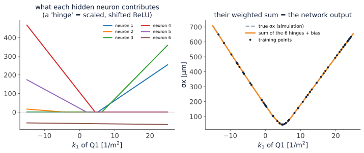{height="340px" fig-align="center"}

::: {.box .small}
A network with **one hidden layer of 6 ReLU neurons**, trained on our beam-size scan.
Each neuron contributes a **hinge** (left: weight × ReLU, shifted by its bias). The output neuron
**adds** the 6 hinges (right). Training chooses where each hinge bends and how steep it is.
More neurons ⇒ more hinges ⇒ finer approximation of any curve.
:::

::: notes
This is the key intuition: a ReLU network is a piecewise-linear function whose pieces are
learned. Here 6 neurons are enough because the curve is simple (almost a V).
With several inputs, each hinge becomes a "fold" in a higher-dimensional landscape.
:::

## From neurons to a network

:::: {.columns}
::: {.column width="55%"}
{width="100%"}
:::
::: {.column width="45%"}
- **Input layer**: the numbers we know (3 magnet strengths)
- **Hidden layers**: neurons fed by the previous layer; each layer combines the features of the one before
- **Output layer**: the predictions (σx, σy), usually without activation

::: {.box-orange .small}
<span class="box-title">How many parameters?</span>
The network of exercise 1: 3 → 64 → 64 → 64 → 2.
<br>Each neuron has one weight per input + one bias:
$(3{\cdot}64{+}64) + 2\,(64{\cdot}64{+}64) + (64{\cdot}2{+}2) =$ **8 706**.
:::
::: {.box-navy .small}
"**Deep** learning" = networks with many hidden layers.
:::
:::
::::

## How a network learns

::: {.cards-4}
::: {.box}
<span class="box-title">① Forward pass</span>
Feed the inputs of a batch of samples through the network → predictions $\hat y$.
:::
::: {.box-orange .fragment}
<span class="box-title">② Loss</span>
Compare with the targets: $L$ = mean of $(\hat y - y)^2$.
:::
::: {.box-teal .fragment}
<span class="box-title">③ Backward pass</span>
**Backpropagation**: the chain rule, applied layer by layer from the output back to the input,
gives $\partial L/\partial w$ for **every** weight.
:::
::: {.box-navy .fragment}
<span class="box-title">④ Update</span>
Move every weight a little downhill: $w \leftarrow w - \eta\,\partial L/\partial w$.
:::
:::

::: {.fragment}
Repeat ①–④. One pass over the whole dataset = one **epoch**; training takes tens to thousands of epochs.

::: {.box-teal .small}
You never write the derivatives yourself: libraries (PyTorch, JAX, TensorFlow) compute them
automatically (**automatic differentiation**). In scikit-learn, one line: `MLPRegressor().fit(X, y)`.
:::
:::

::: notes
Data are usually shown to the network in small batches (mini-batches) rather than all at once:
cheaper and the noise even helps. Adam is the most common variant of gradient descent.
:::

## Watching a network learn

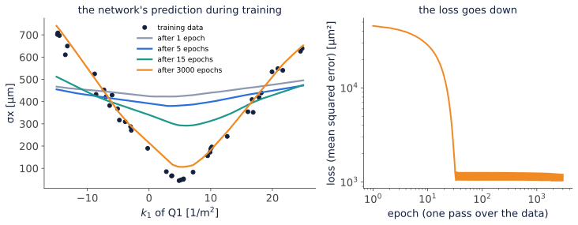{height="340px" fig-align="center"}

::: {.box .small}
Network with 2 hidden layers of 32 neurons, trained on 40 noisy measurements.
At the start the weights are **random**: the prediction is almost flat. Epoch after epoch,
gradient descent bends it toward the data, and the loss decreases until it reaches the
**noise level** of the measurements — it cannot (and should not) do better.
:::

## Generalisation: the danger of overfitting

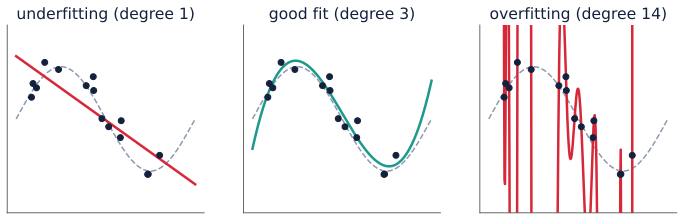{height="260px" fig-align="center"}

:::: {.columns}
::: {.column width="33%"}
::: {.box-red .small}
**Underfitting**: model too rigid, misses the trend.
:::
:::
::: {.column width="33%"}
::: {.box-teal .small}
**Good fit**: captures the trend, ignores the noise.
:::
:::
::: {.column width="33%"}
::: {.box-red .small}
**Overfitting**: passes through every point — including the noise — and predicts nonsense in between.
:::
:::
::::

::: {.center .small}
A model that is perfect on its training data tells you **nothing** about new data.
:::

::: notes
A neural network with many parameters and few data points can overfit just like the
degree-14 polynomial. Remedies: more data, a simpler model, regularisation, early stopping.
:::

## Always keep a test set

:::: {.columns}
::: {.column width="50%"}
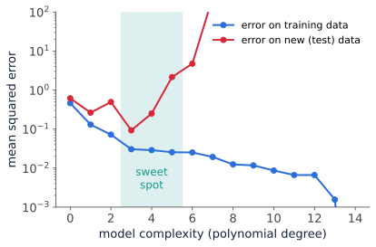{width="100%"}
:::
::: {.column width="50%"}
As the model becomes more flexible, the **training error** always decreases, but the error on
**new data** goes down, then **up**.

::: {.box-navy .small}
<span class="box-title">Split the data before anything else</span>
**training set** (≈ 70 %) to fit · **validation set** (≈ 15 %) to choose the model ·
**test set** (≈ 15 %) for the final, honest score — used **once**.
:::
::: {.box-red .small}
<span class="box-title">On accelerators</span>
Consecutive shots are correlated and the machine drifts: test on data from **another run or day**.
:::
:::
::::

## Neural networks: strengths and limits

::: {.cards-2}
::: {.box-teal}
<span class="box-title">✔ Strengths</span>

- approximate (almost) any function, in many dimensions
- once trained, **very fast** (µs per prediction)
- handle images and time series (beam images, RF waveforms)
:::
::: {.box-red}
<span class="box-title">✘ Limits</span>

- need **a lot of data** (simulation or archived)
- **interpolate** well, **extrapolate** badly — and do not warn you
- hard to interpret ("black box"); no uncertainty by default
:::
:::

::: {.box-orange .small}
**Rule of thumb:** always compare with a simple **baseline** (linear fit, lookup table…).
The neural network must beat it to be worth it.
:::

# A tour of the methods {background-color="#14213d" .section-slide}

## 1 · Surrogate models: the idea

::: {.big-quote}
Replace a slow simulation (or a measurement) by a fast neural network trained to imitate it.
:::

::: {.cards-4}
::: {.box}
<span class="box-title">① Generate data</span>
Run the simulator for thousands of random settings (on a cluster, once).
:::
::: {.box-orange}
<span class="box-title">② Train</span>
Fit a neural network: settings → simulated outputs.
:::
::: {.box-teal}
<span class="box-title">③ Validate</span>
Check it on simulations it has never seen (test set).
:::
::: {.box-navy}
<span class="box-title">④ Use</span>
Millions of predictions per second: scans, optimisation, online model in the control room.
:::
:::

::: {.box-teal .small}
<span class="box-title">Virtual diagnostic</span>
Same idea with measured data: predict a quantity that is destructive or slow to measure
(e.g. the longitudinal phase space) from signals that are always available.
:::

::: notes
This is exactly exercise 1, on the 3-quadrupole beamline.
:::

## Surrogate models in practice

:::: {.columns}
::: {.column width="40%"}
{height="400px"}
:::
::: {.column width="60%"}
**Parity plot**: each point is one test setting. On the diagonal = perfect prediction.

::: {.box .small}
Network 3 → 64 → 64 → 64 → 2 trained on 2400 simulations of the exercise beamline;
it predicts **log σ** (beam sizes span 3 orders of magnitude).
:::
::: {.box-red .small}
<span class="box-title">Pitfalls (you will test them)</span>
too few training samples; settings **outside** the training range (extrapolation);
the machine is not the simulation (errors, drifts).
:::
::: {.box-teal .small}
<span class="box-title">In the literature</span>
LCLS / FACET-II longitudinal phase-space virtual diagnostic (Emma *et al.* 2018);
surrogate-based multi-objective optimisation, orders of magnitude faster (Edelen *et al.* 2020).
:::
:::
::::

::: {.ref}
Emma *et al.*, PRAB **21**, 112802 (2018) · Edelen *et al.*, PRAB **23**, 044601 (2020).
:::

## 2 · Bayesian optimisation: the setting

:::: {.columns}
::: {.column width="52%"}
Tuning **on the real machine**:

- no formula and **no gradient**
- every measurement is **noisy**
- every measurement costs **beam time** ⇒ we can afford ~10–100 trials, not 10 000

::: {.box-orange .fragment}
<span class="box-title">How would a careful operator do it?</span>
Remember every trial so far, build a mental picture of the landscape, and choose the next trial
either where it looks **good**, or where they **know too little**.
:::
:::
::: {.column width="48%"}
::: {.box-teal .fragment}
<span class="box-title">Bayesian optimisation does exactly that</span>

1. a **surrogate with uncertainty** of the objective, rebuilt after every measurement:
   the *Gaussian process*
2. a rule to pick the next trial, balancing "good" and "unknown":
   the *acquisition function*
3. measure, add the point, repeat
:::
:::
::::

## The Gaussian process: a fit that knows what it does not know

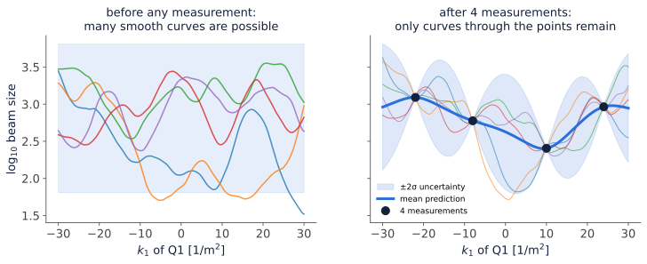{height="320px" fig-align="center"}

:::: {.columns}
::: {.column width="50%"}
::: {.box .small}
A GP considers **all smooth curves** compatible with the data. Where measurements are close,
curves agree: low uncertainty. Far from measurements, they disagree: high uncertainty.
:::
:::
::: {.column width="50%"}
::: {.box-orange .small}
<span class="box-title">The kernel</span>
encodes "nearby settings give similar beams" — with a **length scale**: how far apart two
settings can be and still be similar. It is learned from the data.
:::
:::
::::

::: notes
Each coloured line on the right is one plausible curve; their mean is the prediction and their
spread is the uncertainty. With noisy data, the curves need not pass exactly through the points.
:::

## Explore or exploit? The acquisition function

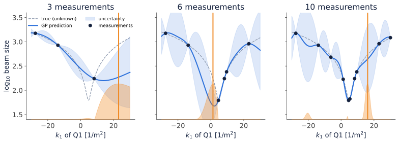{height="290px" fig-align="center"}

:::: {.columns}
::: {.column width="55%"}
::: {.box .small}
**Expected improvement** (orange area): how much a new trial at $x$ is expected to beat the best
value so far. It is large where the prediction is **low** (*exploit*) **or** the uncertainty is
**large** (*explore*). The next trial is at its maximum (orange line).
:::
:::
::: {.column width="45%"}
::: {.box-teal .small}
**Use BO when:** each evaluation is expensive and noisy, no gradients, ≲ 20 knobs.
Now a standard tool in control rooms (e.g. the Xopt library).
:::
:::
::::

::: {.ref}
Duris *et al.*, PRL **124**, 124801 (2020) — BO of the LCLS FEL ·
Roussel *et al.*, PRAB **27**, 084801 (2024) — review · [Xopt](https://github.com/xopt-org/Xopt).
:::

::: notes
Read left to right: with 3 points the GP is uncertain and EI explores; after 6 points it
concentrates near the minimum; after 10 the minimum is well known and EI looks elsewhere.
Exercise 2: code this loop yourself and compare with random search.
:::

## 3 · Anomaly detection: learn what "normal" looks like

:::: {.columns}
::: {.column width="45%"}
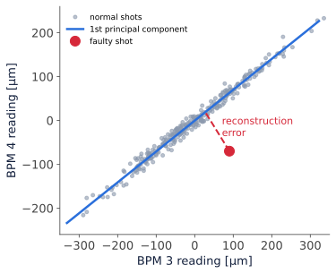{width="100%"}
:::
::: {.column width="55%"}
Two neighbouring BPMs see the **same** orbit jitter: their readings are strongly correlated.
Normal shots lie close to a line.

::: {.box .small .fragment}
<span class="box-title">PCA (principal component analysis)</span>
finds that line (in general: the few directions in which the data vary most) **from the data
alone**, without any optics model.
:::
::: {.box-red .small .fragment}
<span class="box-title">Anomaly score</span>
the distance of a shot to the line (**reconstruction error**). The faulty reading is not large —
it is **inconsistent** with the other BPM.
:::
::: {.box-teal .small .fragment}
No labels needed: this is **unsupervised** learning.
:::
:::
::::

::: notes
With 10 BPMs and 2 steering magnets jittering, normal orbits live on a 2-D plane in a
10-D space; PCA finds this plane. This is exercise 3.
:::

## Another detector: the Isolation Forest

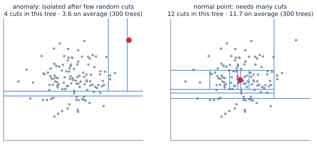{height="330px" fig-align="center"}

::: {.box .small}
Cut the data with **random** vertical/horizontal lines until the point is alone.
Anomalies are "few and different": they are isolated after **few** cuts. Repeat with many random
"trees" and average: the average number of cuts is the anomaly score. No assumption of linearity needed.
:::

## Anomaly detection & fault classification in practice

{height="290px" fig-align="center"}

:::: {.columns}
::: {.column width="50%"}
::: {.box-teal .small}
<span class="box-title">Unsupervised — no labels</span>
Faulty BPMs at the LHC detected with an Isolation Forest.
:::
:::
::: {.column width="50%"}
::: {.box .small}
<span class="box-title">Supervised — with labels</span>
Once experts have labelled past events: classify fault types, e.g. SRF cavity trips at CEBAF from RF waveforms.
:::
:::
::::

::: {.ref}
Fol *et al.*, PRAB **23**, 102805 (2020) — faulty BPM detection (LHC) ·
Tennant *et al.*, PRAB **23**, 114601 (2020) — SRF cavity fault classification (CEBAF).
:::

## 4 · Reinforcement learning: the vocabulary

:::: {.columns}
::: {.column width="52%"}
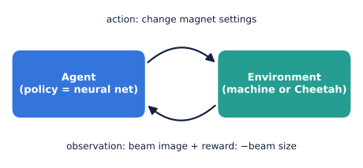{width="100%"}
:::
::: {.column width="48%"}
Example: focus the beam on a screen.

::: {style="font-size:0.8em"}
- **State / observation**: what the agent sees — the beam image, current magnet settings
- **Action**: what it can do — change the magnet strengths a little
- **Reward**: a number saying how good the result is — e.g. minus the beam size
- **Policy**: the agent's strategy, observation → action — usually a neural network
- **Episode**: one attempt, from a random start until the beam is focused (or time is up)
:::
:::
::::

::: notes
Contrast with supervised learning: nobody tells the agent the right action. It only gets a
reward after acting, and must discover good actions itself.
:::

## Reinforcement learning: how the agent learns

:::: {.columns}
::: {.column width="55%"}
1. start with a **random** policy: actions are nonsense
2. play many episodes; record (observation, action, reward)
3. adjust the policy network so that actions leading to **high total reward** become more likely
4. repeat — typically **10⁴–10⁶ episodes**

::: {.box-orange .small}
<span class="box-title">Where do we find a million episodes?</span>
Not on the machine! Train in a **fast simulator** (e.g. Cheetah), with randomised errors so the
agent becomes robust, then deploy on the real machine (*sim-to-real transfer*).
:::
:::
::: {.column width="45%"}
::: {.box-teal .small}
<span class="box-title">Strengths</span>
Once trained, acts in a few steps; can react to changing conditions (feedback).
:::
::: {.box-red .small}
<span class="box-title">Costs</span>
Long training, careful reward design, gap between simulation and reality.
:::
::: {.box .small}
<span class="box-title">RL or BO?</span>
Compared on the same real tuning task at ARES (DESY): RL fast once trained, BO ready
out of the box with no training.
:::
:::
::::

::: {.ref}
Kain *et al.*, PRAB **23**, 124801 (2020) — sample-efficient RL at CERN (AWAKE) ·
Kaiser *et al.*, Sci. Rep. **14**, 15733 (2024) — RL-trained optimisers vs BO at ARES.
:::

::: notes
RL is the most ambitious family and the most expensive to set up. Not covered in the
exercises; good next step: the RL4AA community tutorials, which use Cheetah.
:::

## 5 · Differentiable simulations

:::: {.columns}
::: {.column width="52%"}
A beamline is a chain of elements; the beam at the screen is a **composition** of functions:
$$
\sigma_\text{screen} = f_\text{drift}\big(f_{Q3}\big(\dots f_{Q1}(\text{beam}_0;\,k_1)\dots\big)\big)
$$
The **chain rule** gives $\partial\sigma/\partial k_1$ by multiplying the derivatives of each element.

::: {.box-teal .small}
Write the simulator in an ML framework (PyTorch) ⇒ it does this **automatically**, exactly as
backpropagation in a neural network.
:::
:::
::: {.column width="48%"}
::: {.box .small}
<span class="box-title">What gradients give you</span>

- tune many magnets at once by gradient descent
- fit a model to measurements (*system identification*)
- train RL agents and neural components fast
:::
::: {.box-orange .small}
<span class="box-title">Physics-informed ML</span>
Put physics **into** the model (conservation laws, symplecticity…): less data, better
extrapolation. The trend: **hybrid** physics + ML models.
:::
:::
::::

```python
segment.Q1.k1 = torch.nn.Parameter(torch.tensor(5.0))   # make k1 trainable
loss = segment.track(beam).sigma_x                       # simulate
loss.backward()                                          # d(sigma_x)/d(k1), automatically
```

::: {.ref}
Kaiser *et al.*, PRAB **27**, 054601 (2024) — Cheetah, [github.com/desy-ml/cheetah](https://github.com/desy-ml/cheetah).
:::

::: notes
This is what exercise 0 does in its second half. Students will see that gradient descent
finds two families of solutions depending on the starting point.
:::

## Which method when?

| Method | Learns from | Needs | Typical use | Exercise |
|:--|:--|:--|:--|:--:|
| **Neural-net surrogate** | (input, output) examples | 10³–10⁶ samples, mostly simulation | fast models, virtual diagnostics | 1 |
| **Gaussian process / BO** | each new measurement | 10–100 evaluations, ≲ 20 knobs | online tuning, noisy & expensive | 2 |
| **PCA / Isolation Forest** | unlabelled data | "mostly normal" data | faulty sensors, unusual states | 3 |
| **Classifier** (random forest, NN) | labelled events | expert labels | fault type identification | — |
| **Reinforcement learning** | interaction & reward | 10⁴–10⁶ episodes (simulator) | fast tuning, feedback control | — |
| **Differentiable simulation** | physics model + gradients | a differentiable model | many-knob tuning, model calibration | 0 |

::: {.box-orange .small}
**Rule of thumb:** start with the simplest method that could work (a linear fit, a threshold,
a grid scan) — it is your **baseline**. An ML method must beat it to be worth deploying.
:::

# Good practice {background-color="#14213d" .section-slide}

## What goes wrong in practice

::: {.cards-2}
::: {.box}
<span class="box-title">🔍 Look at the data first</span>
Units, ranges, missing values, saturations, timestamps. Choose a good representation (e.g. log of beam size).
:::
::: {.box-orange}
<span class="box-title">📏 Honest evaluation</span>
Separate test set, from another run or day. Compare with a simple baseline.
:::
::: {.box-teal}
<span class="box-title">❓ Know what the model does not know</span>
Training domain, extrapolation, **uncertainty** (GPs, ensembles). Drifts ⇒ retrain.
:::
::: {.box-red}
<span class="box-title">🛡️ Safety in the control room</span>
Hard limits on actuators, slow ramps, operator in the loop, a "go back" button.
:::
:::

::: {.small .center}
**Toolbox:** scikit-learn (classical ML) · PyTorch (neural nets) · Cheetah (differentiable beam dynamics) ·
Xopt / BoTorch (BO) · Gymnasium + Stable-Baselines3 (RL)
:::

::: notes
These matter more than the choice of algorithm. Most failed ML projects fail on data,
evaluation or deployment, not on the model.
:::

## Take-home messages

::: {.cards-3}
::: {.box}
<span class="icon">1</span>
ML = **fitting flexible models to data**: data, model, loss, optimiser.
A neural network is a sum of many simple "hinges" whose shape is learned by gradient descent.
:::
::: {.box-orange}
<span class="icon">2</span>
Pick the method from the **task** and the **data you have**:
surrogate, BO, anomaly detection, RL, differentiable simulation.
:::
::: {.box-teal}
<span class="icon">3</span>
**Physics + ML** beats either alone. Start simple, keep a test set, know the limits.
:::
:::

## Your turn: the exercises

All notebooks run in the browser on Google Colab (free Google account) — click, then *Runtime → Run all*.

| # | Notebook | Method | |
|:-:|:--|:--|:--:|
| 0 | First beamline with Cheetah | tracking, manual & gradient-based tuning | [](https://colab.research.google.com/github/hayg25/ML4Accelerators/blob/main/notebooks/00_cheetah_basics.ipynb) |
| 1 | Neural-network surrogate | supervised regression | [](https://colab.research.google.com/github/hayg25/ML4Accelerators/blob/main/notebooks/01_surrogate_model.ipynb) |
| 2 | Bayesian optimisation | GP + acquisition function | [](https://colab.research.google.com/github/hayg25/ML4Accelerators/blob/main/notebooks/02_bayesian_optimisation.ipynb) |
| 3 | Faulty BPM detection | unsupervised anomaly detection | [](https://colab.research.google.com/github/hayg25/ML4Accelerators/blob/main/notebooks/03_anomaly_detection.ipynb) |

::: {.box-orange .small}
Cells marked ✏️ are for you. Solutions: `notebooks/solutions/` in the
[GitHub repository](https://github.com/hayg25/ML4Accelerators).
:::

## To go further {.smaller}

::: {.cards-2}
::: {.box}
<span class="box-title">Reviews</span>

- Edelen *et al.*, *Opportunities in machine learning for particle accelerators*, arXiv:1811.03172 (2018)
- Roussel *et al.*, *Bayesian optimization algorithms for accelerator physics*, PRAB **27**, 084801 (2024)
:::
::: {.box-teal}
<span class="box-title">Software</span>

- Cheetah — [github.com/desy-ml/cheetah](https://github.com/desy-ml/cheetah)
- Xopt — [github.com/xopt-org/Xopt](https://github.com/xopt-org/Xopt)
- scikit-learn — [scikit-learn.org](https://scikit-learn.org)
:::
::: {.box-orange}
<span class="box-title">Applications cited</span>

- Emma *et al.*, PRAB **21**, 112802 (2018) · Edelen *et al.*, PRAB **23**, 044601 (2020)
- Duris *et al.*, PRL **124**, 124801 (2020)
- Fol *et al.*, PRAB **23**, 102805 (2020) · Tennant *et al.*, PRAB **23**, 114601 (2020)
- Kain *et al.*, PRAB **23**, 124801 (2020) · Kaiser *et al.*, Sci. Rep. **14**, 15733 (2024)
- Kaiser *et al.*, PRAB **27**, 054601 (2024)
:::
::: {.box-navy}
<span class="box-title">Communities</span>

- ICFA workshops on ML applications for particle accelerators
- RL4AA — reinforcement learning for autonomous accelerators
:::
:::

## Questions? {background-color="#14213d" .section-slide}

<br>

::: {style="color: white; font-size: 0.8em;"}
Slides & exercises: [hayg25.github.io/ML4Accelerators](https://hayg25.github.io/ML4Accelerators/){style="color:#f08a24"}
<br>Source: [github.com/hayg25/ML4Accelerators](https://github.com/hayg25/ML4Accelerators){style="color:#f08a24"}
:::

## Backup — glossary

| Term | Meaning |
|:--|:--|
| **Sample / input / target** | one example; the quantity we know; the quantity to predict |
| **Model, parameters** | function with adjustable numbers (weights) mapping inputs to outputs |
| **Loss** | number measuring how wrong the model is; training minimises it |
| **Gradient descent, learning rate** | walk downhill on the loss; size of each step |
| **Neuron, activation** | weighted sum + bias, followed by a non-linear function (ReLU…) |
| **Backpropagation** | chain rule computing the gradient of the loss for every weight |
| **Epoch** | one pass over the whole training set |
| **Overfitting** | model learns the noise of the training data; poor on new data |
| **Gaussian process, kernel** | regression giving a mean and an uncertainty; kernel = notion of similarity |
| **Acquisition function** | rule deciding where Bayesian optimisation measures next |
| **PCA** | finds the few directions in which the data vary most |
| **Policy, reward, episode** | RL: strategy observation → action; score of an action; one attempt |
| **Differentiable simulation** | simulator that also returns gradients of its outputs |
