## Today's plan

:::: {.columns}
::: {.column width="56%"}

::: {.incremental}
1. **Why machine learning for accelerators?**
2. **Machine learning from scratch**
   - model, loss, training
   - neural networks, step by step
   - overfitting and test sets
3. **A tour of the methods**
   - surrogate models · Bayesian optimisation
   - anomaly detection · reinforcement learning
   - differentiable simulations
4. **Good practice & take-home messages**
:::

:::
::: {.column width="44%"}

::: {.box-orange}
<span class="box-title">Hands-on afterwards</span>
Notebooks that run in your browser on **Google Colab**, using the
differentiable beam-dynamics code **Cheetah**. No installation needed.
:::

::: {.box}
<span class="box-title">Prerequisites</span>
Basic Python. Basic beam optics (drift, quadrupole, beam size).
**No** prior machine-learning knowledge.
:::

::: {.box-teal}
<span class="box-title">One running example</span>
All along, we use the same small beamline: three quadrupoles and a screen.
:::

:::
::::

::: notes
Welcome everyone. In the next hour I want to give you a map of how machine learning is used
around particle accelerators — not a deep dive into any single method, but enough to know what
each method is, what it needs, and when it is the right tool.

The lecture has four parts. First, why accelerators are a good playground for machine learning.
Second, machine learning from scratch: we will build the vocabulary slowly — model, loss,
training — and open the "black box" of neural networks step by step. Third, a tour of five
families of methods, each with a real example from an accelerator. And finally a few rules of
good practice.

One important choice: everything is explained with the same physical example, a small beamline
with three quadrupoles and a screen. You will meet it again in all the exercises, which run in
your browser, so you do not need to install anything.
:::

# Why machine learning for accelerators? {background-color="#14213d" .section-slide}

## An accelerator is a function with many knobs

::: {.r-stack}
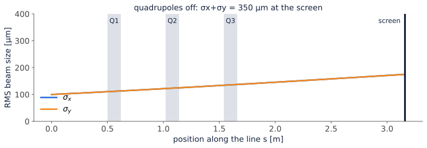{height="330px" fig-align="center"}

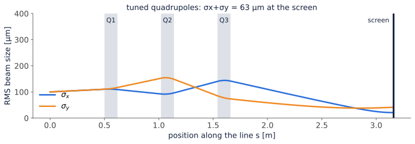{.fragment height="330px" fig-align="center"}
:::

::: {.box .fragment}
**Inputs:** magnet currents, RF phases and amplitudes, laser settings… &nbsp;→&nbsp;
**Outputs:** beam size, position, energy spread, losses, FEL pulse energy…
<br>Three quadrupoles here; **hundreds to thousands** of knobs on a real machine.
:::

::: notes
Here is our running example. An electron beam enters on the left, goes through three
quadrupoles — the grey bands — and hits a screen on the right. The blue curve is the horizontal
beam size, the orange one the vertical.

With all quadrupoles off, the beam simply diverges: it reaches more than 300 µm on the screen.
[click] With well-chosen strengths, the beam is focused: about 60 µm in total. Notice that a
quadrupole always focuses in one plane and defocuses in the other — that is why we need several
of them, with alternating signs.

[click] The key idea of this lecture: from the outside, an accelerator is a function. Inputs are
the settings of the machine, outputs are the properties of the beam. Tuning means finding the
inputs that give the outputs we want. With three knobs, an operator can do it by hand — you will
do it in exercise 0. With three hundred, it becomes impossible, and that is where algorithms help.
:::

## What makes it hard?

::: {.cards-3}
::: {.box .fragment}
<span class="icon">🎛️</span>
<span class="box-title">Many coupled parameters</span>
Changing one magnet changes the optimum of all the others.
:::
::: {.box-orange .fragment}
<span class="icon">📉</span>
<span class="box-title">Noisy, partial diagnostics</span>
Shot-to-shot jitter; many quantities cannot be measured without destroying the beam.
:::
::: {.box-teal .fragment}
<span class="icon">🌡️</span>
<span class="box-title">Drifts</span>
Temperature, ageing, hysteresis: yesterday's optimum is not today's.
:::
::: {.box-navy .fragment}
<span class="icon">🖥️</span>
<span class="box-title">Expensive simulations</span>
Space charge, CSR, wakefields: minutes to hours per run.
:::
::: {.box-red .fragment}
<span class="icon">⏱️</span>
<span class="box-title">Precious beam time</span>
Every tuning minute is taken from the users.
:::
::: {.box .fragment}
<span class="icon">🗄️</span>
<span class="box-title">…but lots of data</span>
Archived signals from thousands of sensors, every second.
:::
:::

::: notes
Why is this hard? Let me reveal six reasons one by one.

[click] The parameters are coupled: the best setting of one magnet depends on all the others, so
you cannot optimise them one at a time.

[click] Diagnostics are noisy and incomplete. Some quantities, like the longitudinal phase
space, can only be measured with destructive or slow devices.

[click] The machine drifts: temperature, ageing, hysteresis. The optimum found this morning may
not hold tonight.

[click] Simulations that include collective effects — space charge, coherent synchrotron
radiation, wakefields — can take minutes to hours per run.

[click] Beam time is expensive: every minute spent tuning is a minute taken from the users.

[click] And the last point is the good news: accelerators produce enormous amounts of data.
Thousands of sensors are archived every second. Data plus hard problems — that is exactly
where machine learning is useful.
:::

## Four families of tasks

::: {.cards-4}
::: {.box .fragment}
<span class="icon">🎯</span>
<span class="box-title">Tune & optimise</span>
Find the best settings with as few trials as possible.
<br><span class="muted small">→ Bayesian optimisation, RL, gradients</span>
:::
::: {.box-teal .fragment}
<span class="icon">🔮</span>
<span class="box-title">Model & predict</span>
Fast surrogates of simulations; "virtual diagnostics" of unmeasurable quantities.
<br><span class="muted small">→ supervised learning</span>
:::
::: {.box-red .fragment}
<span class="icon">🚨</span>
<span class="box-title">Detect & diagnose</span>
Faulty sensors, RF trips, beam losses, before they hurt.
<br><span class="muted small">→ anomaly detection, classification</span>
:::
::: {.box-orange .fragment}
<span class="icon">🔁</span>
<span class="box-title">Control</span>
Keep the beam stable against drifts, act in real time.
<br><span class="muted small">→ reinforcement learning</span>
:::
:::

::: {.fragment}
::: {.big-quote}
ML does not replace beam physics — it **uses** it, and fills the gaps.
:::
:::

::: notes
Almost every application of machine learning around an accelerator falls into one of four
families.

[click] Tuning and optimisation: find the best settings with as few trials as possible.

[click] Modelling and prediction: build fast replacements of slow simulations, or predict
quantities we cannot measure directly — so-called virtual diagnostics.

[click] Detection and diagnosis: spot faulty sensors, predict RF trips or beam losses.

[click] Control: keep the beam stable in real time against drifts.

[click] And one message I will repeat: machine learning does not replace beam physics. The best
results always combine physics knowledge with learning from data. Keep these four families in
mind: they are the map of the rest of the lecture. A good overview is the paper by Edelen et
al., "Opportunities in machine learning for particle accelerators", 2018.
:::

# Machine learning from scratch {background-color="#14213d" .section-slide}

## From writing rules to learning them

:::: {.columns}
::: {.column width="48%"}
::: {.box-navy}
<span class="box-title">Classical approach</span>
A human writes the **rules** (physics model, thresholds); the computer applies them to data.
<br><span class="small muted">e.g. "flag a BPM if |x| > 2 mm"</span>
:::
:::
::: {.column width="4%"}
:::
::: {.column width="48%"}
::: {.box-orange .fragment}
<span class="box-title">Machine learning</span>
The computer **finds the rules** from examples (or from a goal). The result is called a **model**.
<br><span class="small muted">e.g. "learn what normal BPM data look like"</span>
:::
:::
::::

::: {.fragment}
::: {.big-quote}
A program **learns** when its performance on a task, measured by some metric,
improves with experience (= data).
:::
<div class="center small muted">— paraphrasing T. Mitchell, <em>Machine Learning</em> (1997)</div>
:::

::: notes
What is machine learning, concretely? In the classical approach, a human writes the rules:
a physics model, or simple thresholds such as "flag a beam position monitor if it reads more
than 2 mm".

[click] In machine learning, we give the computer examples — or a goal — and it finds the rules
itself. What it produces is called a model.

[click] A classic definition, paraphrasing Tom Mitchell: a program learns when its performance
on a task, measured by some metric, improves with experience — that is, with data. Keep these
three words in mind: task, metric, data. For every method in this lecture, ask yourself: what
is the task, how is performance measured, and where do the data come from?

Machine learning is useful when the rules are too complicated to write down, or simply unknown,
but examples exist.
:::

## Three ways to learn

::: {.cards-3}
::: {.box .fragment}
<span class="box-title">Supervised</span>
Examples **with the right answer**: (input, output) pairs. Learn the mapping input → output.
<br><br>**Accelerator example:** magnet settings → beam size; RF signals → fault type.
:::
::: {.box-teal .fragment}
<span class="box-title">Unsupervised</span>
Data **without** answers. Find structure: groups, low-dimensional patterns, outliers.
<br><br>**Accelerator example:** spot faulty BPMs in logged data.
:::
::: {.box-orange .fragment}
<span class="box-title">Reinforcement</span>
An agent **acts**, receives a **reward**, and improves its strategy by trial and error.
<br><br>**Accelerator example:** learn to focus the beam by moving magnets.
:::
:::

::: {.center .small .muted .fragment}
We start with **supervised** learning: it contains all the key ideas.
:::

::: notes
There are three ways to learn.

[click] Supervised learning: we have examples with the right answer — pairs of inputs and
outputs — and we learn the mapping. For instance magnet settings and the resulting beam size,
or RF signals labelled with the type of fault that followed.

[click] Unsupervised learning: we only have data, no answers. The goal is to find structure:
groups, patterns, or points that do not fit. Example: finding faulty beam position monitors in
archived data, where nobody has labelled the faults.

[click] Reinforcement learning: an agent acts on a system, receives a reward, and improves its
strategy by trial and error — like learning to focus the beam by moving magnets.

[click] We start with supervised learning because it contains all the key ideas; the other two
reuse them.
:::

## Our running example: a dataset

:::: {.columns}
::: {.column width="45%"}

We scan quadrupole **Q1** and record the beam size **σx** on the screen — 25 measurements.

| sample | input $x$<br>$k_1$ of Q1 [1/m²] | target $y$<br>σx [µm] |
|:-:|:-:|:-:|
| 1 | −11.8 | 527 |
| 2 | 2.2 | 104 |
| 3 | 9.4 | 148 |
| 4 | 21.1 | 513 |
| … | … | … |
| 25 | 24.4 | 615 |

:::
::: {.column width="55%"}

::: {.box .fragment}
<span class="box-title">Vocabulary</span>
One row = a **sample**. The quantity we know = the **input** (or *feature*). The quantity we
want to predict = the **target** (or *label*). All rows = the **dataset**.
:::

::: {.box-orange .fragment}
<span class="box-title">The question</span>
Can the computer learn the relation $y = f(x)$ **from these 25 rows alone**,
without being told the beam-optics formula?
:::

::: {.box-teal .fragment}
<span class="box-title">Why bother, here?</span>
Here we know the physics. But with 300 magnets, space charge and imperfections, we often don't — the same recipe still works.
:::

:::
::::

::: notes
Let us make this concrete. We scan the strength of the first quadrupole and record the
horizontal beam size on the screen: 25 measurements, with about 6 % noise.

[click] Some vocabulary. Each row is a sample. What we know — here the quadrupole strength —
is the input, also called feature. What we want to predict — the beam size — is the target, or
label. All the rows together form the dataset.

[click] The question of supervised learning: can the computer learn the relation between input
and output from these 25 rows alone, without being told the formula of beam optics?

[click] Of course, here we know the physics: a few 2×2 matrices give the answer exactly. But
on a real machine with hundreds of magnets, space charge and imperfections, nobody can write
the formula — and the same recipe still works. Using a case where we know the answer lets us
check that the method works.
:::

## The four ingredients of (almost) every ML method

:::: {.columns}
::: {.column width="55%"}

::: {.incremental}
1. **Data** — the samples $(x_i, y_i)$
2. **Model** — a function with adjustable parameters $\theta$: $\hat y = f_\theta(x)$
   <br><span class="small muted">a straight line has 2 parameters: $\hat y = \theta_1 x + \theta_0$</span>
3. **Loss** — one number saying how wrong the model is on the data
4. **Optimiser** — a procedure that changes $\theta$ to make the loss smaller
:::

:::
::: {.column width="45%"}
::: {.box-teal .fragment}
<span class="box-title">Physicist's translation</span>
This is **fitting**! A least-squares fit of a line is already machine learning.
:::
::: {.box-orange .fragment}
<span class="box-title">What is new?</span>
Models that are much more **flexible** (thousands of parameters), and a strong focus on
predicting **new** data correctly.
:::
:::
::::

::: notes
Almost every machine-learning method has four ingredients.

[click] Data: the samples. [click] A model: a function with adjustable parameters, usually
written theta. A straight line has two parameters, the slope and the offset. [click] A loss: a
single number that says how wrong the model is on the data. [click] An optimiser: a procedure
that changes the parameters to make the loss smaller.

[click] If you are a physicist, you already know this: it is fitting! A least-squares fit of a
straight line is, strictly speaking, machine learning.

[click] So what is new? Two things: the models are much more flexible — thousands or millions of
parameters instead of two — and the goal is not to describe the data we have, but to predict
data we have not seen yet. Keep this in mind, we will come back to it with overfitting.

You will find these four ingredients everywhere: in Bayesian optimisation the model is a
Gaussian process; in reinforcement learning the model is the policy and the loss is minus the
reward.
:::

## Measuring how wrong a model is: the loss

::: {.r-stack}
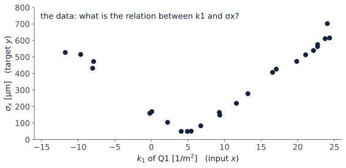{height="330px" fig-align="center"}

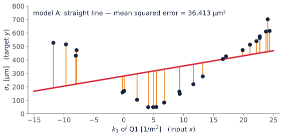{.fragment height="330px" fig-align="center"}

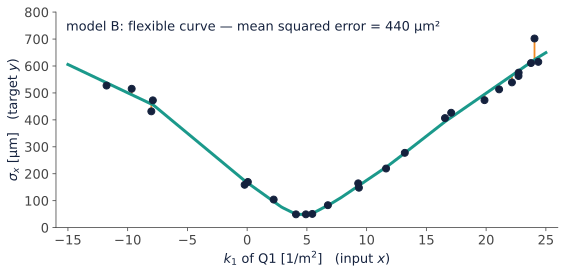{.fragment height="330px" fig-align="center"}
:::

:::: {.columns}
::: {.column width="55%"}
For each sample, the **residual** (orange) is the gap between data and model.
The **mean squared error** averages the squared residuals:
$$
L(\theta) = \frac{1}{N}\sum_{i=1}^{N} \left(f_\theta(x_i) - y_i\right)^2
$$
:::
::: {.column width="45%"}
::: {.box .small .fragment}
Squaring makes every error positive and penalises big errors strongly.
**Training = finding the parameters θ with the smallest loss.**
A straight line cannot do better than model A: we need a more **flexible** model.
:::
:::
::::

::: notes
Here are our 25 measurements. What relation do you see? A V shape: the beam is smallest around
k1 ≈ 5, where the quadrupole focuses the beam onto the screen.

[click] First model: a straight line. The orange segments are the residuals: the difference
between each measurement and the model. To get a single number, we square them — so that
positive and negative errors do not cancel, and big errors count a lot — and average them. This
is the mean squared error: here about 36 000 µm², that is typical errors of about 190 µm. The
best straight line is simply bad: the model is not flexible enough.

[click] Second model: a flexible curve — in fact a small neural network trained on the same 25
points. The residuals almost vanish: 440 µm², about 20 µm typical error, which is the noise
level of the data.

[click] So training means: find the parameters with the smallest loss. And to describe this
V-shaped curve we need a flexible model. How do we find the parameters? That is the next slide.
:::

## Training = walking downhill on the loss

::: {.r-stack}
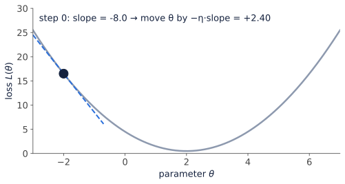{height="360px" fig-align="center"}

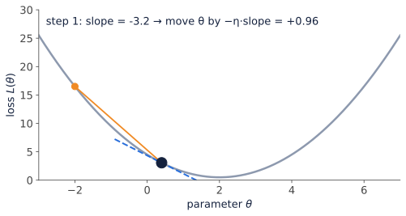{.fragment height="360px" fig-align="center"}

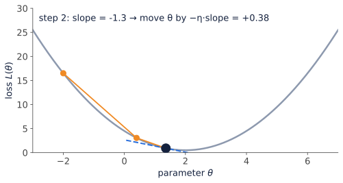{.fragment height="360px" fig-align="center"}

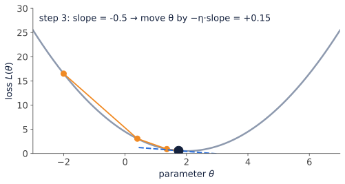{.fragment height="360px" fig-align="center"}

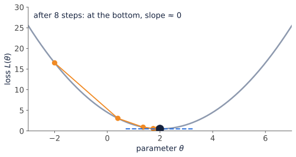{.fragment height="360px" fig-align="center"}
:::

**Gradient descent**, repeated many times:
<br>① compute the **slope** of the loss, $\partial L/\partial\theta$<br>
② take a small step **downhill**: $\theta \leftarrow \theta - \eta\,\dfrac{\partial L}{\partial\theta}$

::: notes
How do we find the parameters with the smallest loss? Imagine a hiker in the fog on a hill: they
cannot see the valley, but they can feel the slope under their feet. The strategy: take a step
downhill, feel the slope again, take another step.

Here the grey curve is the loss as a function of one parameter, theta. We start at the dark
dot. [click] We compute the slope — the dashed blue tangent — and move theta by minus the learning
rate times the slope. Since the slope is negative, we move to the right. [click] Again: the slope
is smaller, so the step is smaller. [click] Again. [click] After a few steps we are at the bottom,
where the slope is zero.

This is gradient descent: the same algorithm trains almost every neural network in the world.
:::

## The step size: the learning rate η

{height="330px" fig-align="center"}

::: {.cards-3}
::: {.box-red .small .fragment}
**Too small:** every step is tiny — training crawls.
:::
::: {.box-teal .small .fragment}
**Reasonable:** a few steps reach the minimum.
:::
::: {.box-red .small .fragment}
**Too large:** steps overshoot, jump from side to side — training **diverges**.
:::
:::

::: {.center .small .fragment}
When a training does not work, the learning rate is **the first knob to adjust**.
:::

::: notes
The step size, called the learning rate eta, matters a lot. Same loss, three learning rates.

[click] Too small, left: every step is tiny and we crawl towards the minimum. [click] Reasonable,
middle: we converge in a few steps. [click] Too large, right: we overshoot and jump from one side
of the valley to the other, further and further — the training diverges.

[click] When a training does not work, the learning rate is the first knob to try. Modern
optimisers such as Adam adapt the step size automatically, but they still have a learning rate.
:::

## The same idea in two (or 10 000) dimensions

:::: {.columns}
::: {.column width="48%"}
::: {.r-stack}
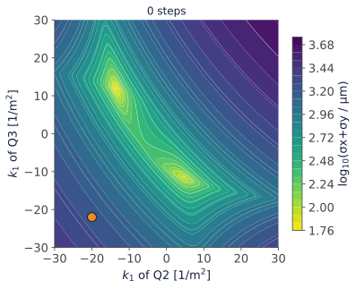{width="100%"}

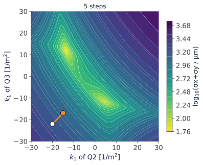{.fragment width="100%"}

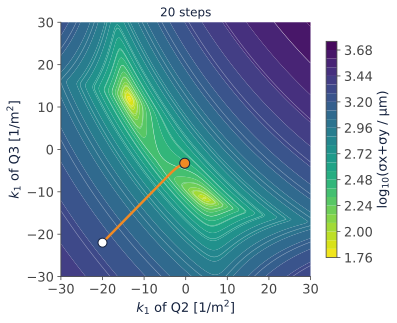{.fragment width="100%"}

{.fragment width="100%"}
:::
:::
::: {.column width="52%"}
Here the two parameters are **quadrupole strengths** and the "loss" is the beam size at the
screen (Q1 fixed). Colours = height of the landscape.

::: {.box .small}
The orange path is gradient descent (Adam variant) starting from the white dot:
it follows the valley to a minimum ★.
:::
::: {.box-red .small .fragment}
Gradient descent is **local**: it finds the bottom of the valley it starts in, not
necessarily the deepest one. You will see this in exercise 0.
:::
::: {.box-teal .small .fragment}
Training a neural network = exactly this, with thousands of parameters (the weights).
:::
:::
::::

::: notes
The same idea works in any number of dimensions. Here the landscape is the beam size on the
screen as a function of two quadrupole strengths — Q2 horizontally, Q3 vertically. Yellow is
small beam, dark is large beam. There are two valleys.

We start from the white dot. [click] After 5 steps, we are going down the slope. [click] After
20 steps, we enter a valley. [click] After 150 steps, we sit at the bottom of the valley: the star.

[click] An important limitation: gradient descent is local. It finds the bottom of the valley it
starts in — not necessarily the deepest one. Starting elsewhere, we could end in the other
valley. You will see this in exercise 0.

[click] Training a neural network is exactly this, except that the parameters are thousands of
weights instead of two quadrupole strengths, and the landscape is the loss.
:::

## Neural networks, step by step {background-color="#14213d" .section-slide}

## Why do we need neural networks?

::: {.cards-3}
::: {.box .fragment}
<span class="box-title">1 · We rarely know the formula</span>
For a real machine (errors, space charge, many coupled knobs), nobody can write $y=f(x)$ by hand.
:::
::: {.box-orange .fragment}
<span class="box-title">2 · Classical fits do not scale</span>
A polynomial in 1 variable is easy. In 100 variables, the number of terms explodes.
:::
::: {.box-teal .fragment}
<span class="box-title">3 · We want a universal "Lego"</span>
One simple building block, repeated and combined, able to approximate **any** smooth function.
:::
:::

::: {.fragment}
::: {.big-quote}
A neural network is that Lego: many copies of one very simple brick — the **neuron** —
whose parameters are found by gradient descent.
:::
:::

::: notes
Now let us open the black box of neural networks. Why do we need them at all?

[click] First, for a real machine we rarely know the formula: errors, collective effects and
coupling make it impossible to write by hand.

[click] Second, classical flexible fits do not scale. A polynomial of one variable is easy;
a polynomial of degree 3 in 100 variables has about 180 000 terms.

[click] Third, what we would like is a universal Lego: one simple building block that we can
repeat and combine to approximate any smooth function.

[click] A neural network is exactly that: many copies of one very simple brick, the neuron,
whose parameters are found by the gradient descent we just saw. There is nothing biological or
magical about it: the name comes from a loose analogy with brain cells, proposed in 1943 by
McCulloch and Pitts. It is just a big parametrised function.
:::

## The brick: one artificial neuron

{height="220px" fig-align="center"}

:::: {.columns}
::: {.column width="50%"}
::: {.incremental}
1. multiply each input by a **weight** $w_j$ (how much it matters, and with which sign)
2. add them up, plus a **bias** $b$ (an offset)
3. pass the result through an **activation function**, here ReLU: keep $z$ if positive, else 0
:::
:::
::: {.column width="50%"}
::: {.box-orange .small .fragment}
<span class="box-title">Worked example</span>
inputs $k = (5,\,-13,\,12)$, weights $w = (0.2,\,-0.1,\,0.05)$, bias $b = 0.5$
<br>$z = 0.2\cdot5 + (-0.1)(-13) + 0.05\cdot12 + 0.5$
<br>$\phantom{z} = 1.0 + 1.3 + 0.6 + 0.5 = 3.4$
<br>$a = \max(0,\,3.4) = 3.4$
:::
::: {.box-navy .small .fragment}
Another neuron with $w = (-0.3,\,0.1,\,0)$, $b = 0.2$ gives $z = -2.6$, so $a = 0$:
this neuron is "off" for this input.
:::
:::
::::

::: notes
Here is the brick. A neuron takes some inputs — here our three quadrupole strengths — and does
three things.

[click] It multiplies each input by a weight. The weight says how much this input matters, and
with which sign. [click] It adds everything up, plus a constant called the bias — an offset.
[click] And it passes the result through an activation function. The most common one is called
ReLU: if the sum is positive, keep it; if negative, output zero.

[click] Let us do it by hand. Inputs 5, −13 and 12; weights 0.2, −0.1 and 0.05; bias 0.5. The
weighted sum is 1 + 1.3 + 0.6 + 0.5 = 3.4. It is positive, so the output is 3.4.

[click] Another neuron, with other weights, gives −2.6 for the same input: negative, so the
output is zero. We say this neuron is "off" for this input.

The weights and the bias are the parameters that training adjusts. One neuron alone is a poor
model — a straight line with a kink. The power comes from combining many of them.
:::

## Why an activation function?

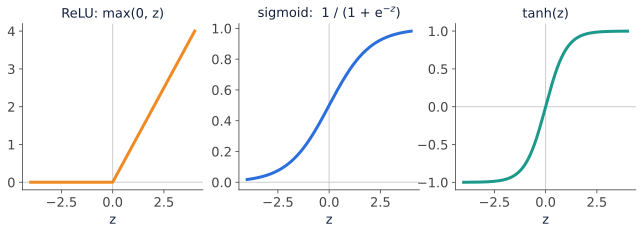{height="230px" fig-align="center"}

:::: {.columns}
::: {.column width="50%"}
::: {.box-red .small .fragment}
<span class="box-title">Without activation</span>
Each neuron is a weighted sum = a **linear** function. Combining linear functions only gives
another linear function: the whole network would be a straight line (model A!).
:::
:::
::: {.column width="50%"}
::: {.box-teal .small .fragment}
<span class="box-title">With activation</span>
The small non-linearity (a kink for ReLU, an S-shape for sigmoid/tanh) is what lets the network
**bend**. ReLU is the most common today: simple and fast.
:::
:::
::::

::: notes
Why do we need this activation function at all? Here are the three most common ones: ReLU, the
sigmoid, and the hyperbolic tangent.

[click] Without activation, a neuron is just a weighted sum: a linear function. And a linear
function of linear functions is still linear. No matter how many neurons you stack, the whole
network would be a straight line — our bad model A.

[click] The activation adds a small non-linearity — a kink for ReLU, an S-shape for the others —
and this is what allows the network to bend. ReLU is the most used today because it is simple
and fast to compute. Let us see on the next slide how kinks build a curve.
:::

## Building a curve from neurons

::: {.r-stack}
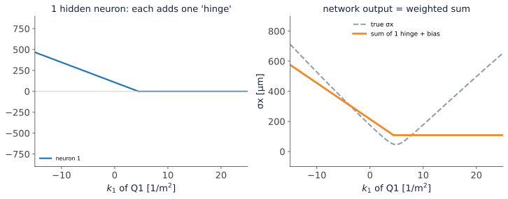{height="330px" fig-align="center"}

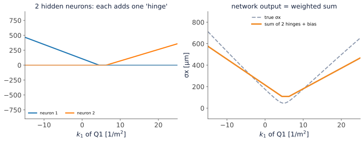{.fragment height="330px" fig-align="center"}

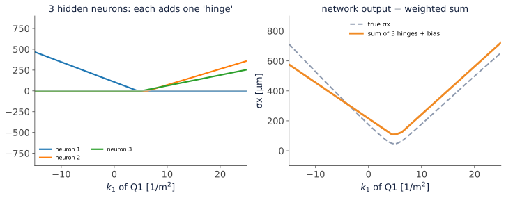{.fragment height="330px" fig-align="center"}

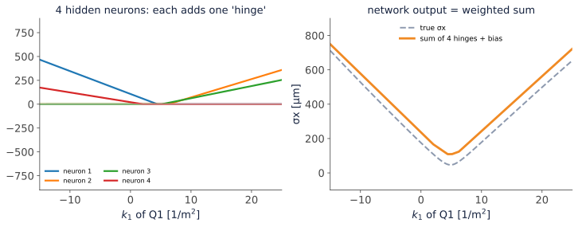{.fragment height="330px" fig-align="center"}

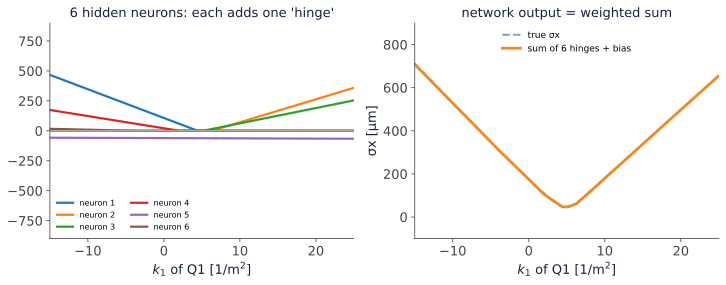{.fragment height="330px" fig-align="center"}
:::

::: {.box .small}
A network with **one hidden layer of 6 ReLU neurons**, trained on our beam-size scan.
Each neuron contributes a **hinge** (left). The output neuron **adds** the hinges (right).
Training chooses where each hinge bends and how steep it is.
More neurons ⇒ more hinges ⇒ finer approximation of any curve.
:::

::: notes
This is the key slide to understand neural networks. We trained a small network — one hidden
layer of six ReLU neurons — on the beam-size scan. Let us look inside.

On the left, what one neuron contributes: a "hinge", flat on one side and a straight line on the
other. The position of the kink is set by its bias, the steepness by its weights. On the right,
the output of the network: the sum of the hinges, compared to the true curve in dashed grey.

With one neuron we get the left arm of the V. [click] A second hinge adds the right arm. [click]
A third one refines the slope. [click] Four. [click] And with six neurons, the sum follows the
true curve closely.

So a ReLU network is a piecewise-linear function whose pieces are learned. Training chooses
where each hinge bends and how steep it is. More neurons give more hinges, and a finer
approximation of any curve. With several inputs, each hinge becomes a fold in a
higher-dimensional landscape, but the principle is the same.
:::

## From neurons to a network

:::: {.columns}
::: {.column width="55%"}
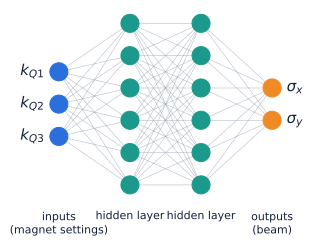{width="100%"}
:::
::: {.column width="45%"}
::: {.incremental}
- **Input layer**: the numbers we know (3 magnet strengths)
- **Hidden layers**: neurons fed by the previous layer; each layer combines the features of the one before
- **Output layer**: the predictions (σx, σy), usually without activation
:::

::: {.box-orange .small .fragment}
<span class="box-title">How many parameters?</span>
The network of exercise 1: 3 → 64 → 64 → 64 → 2.
<br>Each neuron has one weight per input + one bias:
$(3{\cdot}64{+}64) + 2\,(64{\cdot}64{+}64) + (64{\cdot}2{+}2) =$ **8 706**.
:::
::: {.box-navy .small .fragment}
"**Deep** learning" = networks with many hidden layers.
:::
:::
::::

::: notes
Now we organise neurons in layers.

[click] The input layer is just the numbers we know: here three magnet strengths. [click] The
hidden layers are neurons fed by all the neurons of the previous layer. Each layer combines the
features computed by the previous one: hinges of hinges. [click] The output layer gives the
predictions — here two beam sizes — usually without activation, so it can take any value.

[click] How many parameters does this have? In exercise 1 you will use 3 inputs, three hidden
layers of 64 neurons, and 2 outputs. Each neuron has one weight per input plus one bias. That
makes 8 706 parameters — all adjusted by gradient descent.

[click] When people say "deep learning", they simply mean networks with many hidden layers.
:::

## How a network learns

::: {.cards-4}
::: {.box .fragment}
<span class="box-title">① Forward pass</span>
Feed the inputs of a batch of samples through the network → predictions $\hat y$.
:::
::: {.box-orange .fragment}
<span class="box-title">② Loss</span>
Compare with the targets: $L$ = mean of $(\hat y - y)^2$.
:::
::: {.box-teal .fragment}
<span class="box-title">③ Backward pass</span>
**Backpropagation**: the chain rule, applied layer by layer from the output back to the input,
gives $\partial L/\partial w$ for **every** weight.
:::
::: {.box-navy .fragment}
<span class="box-title">④ Update</span>
Move every weight a little downhill: $w \leftarrow w - \eta\,\partial L/\partial w$.
:::
:::

::: {.fragment}
Repeat ①–④. One pass over the whole dataset = one **epoch**; training takes tens to thousands of epochs.

::: {.box-teal .small}
You never write the derivatives yourself: libraries (PyTorch, JAX, TensorFlow) compute them
automatically (**automatic differentiation**). In scikit-learn, one line: `MLPRegressor().fit(X, y)`.
:::
:::

::: notes
How does a network learn? A loop of four steps.

[click] Forward pass: we feed the inputs of a batch of samples through the network and get
predictions. [click] Loss: we compare the predictions with the targets, for example with the mean
squared error. [click] Backward pass: we need the slope of the loss with respect to every single
weight. The trick, called backpropagation, is the chain rule of calculus, applied layer by layer
from the output back to the input. It gives all the derivatives at the cost of about one extra
forward pass. [click] Update: every weight takes a small step downhill.

[click] We repeat this loop. One pass over the whole dataset is called an epoch; training takes
tens to thousands of epochs.

Good news: you never write these derivatives yourself. Libraries like PyTorch compute them
automatically — this is called automatic differentiation. In scikit-learn, which we use in the
exercises, the whole loop is one line.
:::

## Watching a network learn

::: {.r-stack}
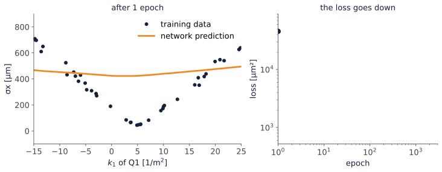{height="350px" fig-align="center"}

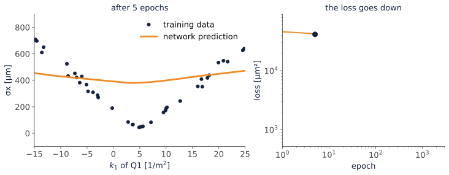{.fragment height="350px" fig-align="center"}

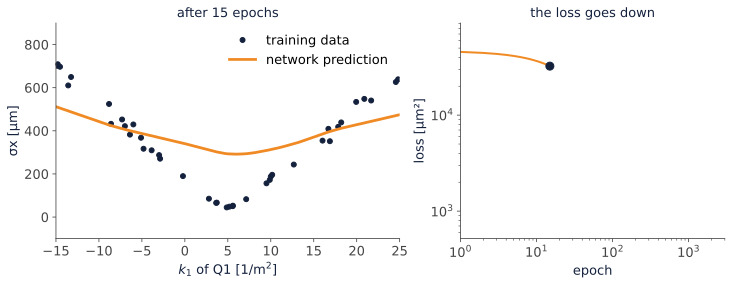{.fragment height="350px" fig-align="center"}

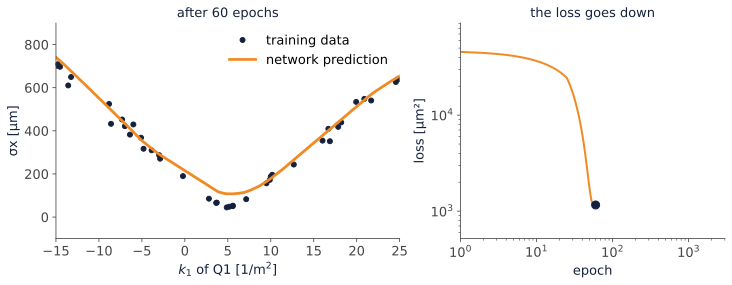{.fragment height="350px" fig-align="center"}

{.fragment height="350px" fig-align="center"}
:::

::: {.box .small}
Network with 2 hidden layers of 32 neurons, trained on 40 noisy measurements.
At the start the weights are **random**: the prediction is almost flat. Epoch after epoch,
gradient descent bends it toward the data, and the loss decreases until it reaches the
**noise level** of the measurements — it cannot (and should not) do better.
:::

::: notes
Let us watch a network learn. Two hidden layers of 32 neurons, trained on 40 noisy measurements.
On the left, the prediction; on the right, the loss versus the number of epochs, on log scales.

After one epoch, the weights are still essentially random: the prediction is almost flat.
[click] After 5 epochs, it starts to tilt. [click] After 15, it bends. [click] After 60, the V
shape appears, and the loss drops by more than an order of magnitude. [click] After 3000 epochs,
the network follows the data, and the loss has reached a plateau.

Why a plateau? Because the measurements have about 6 % noise: the network cannot — and should
not — do better than the noise. If the loss went much lower, it would mean the network is
learning the noise itself. That is the subject of the next slide.
:::

## Generalisation: the danger of overfitting

::: {.r-stack}
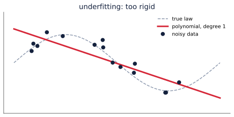{height="300px" fig-align="center"}

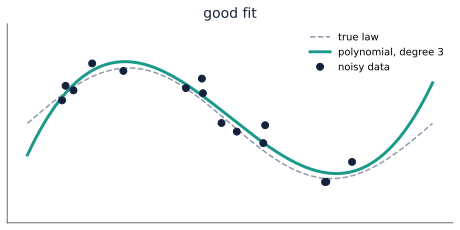{.fragment fragment-index="1" height="300px" fig-align="center"}

{.fragment fragment-index="2" height="300px" fig-align="center"}
:::

:::: {.columns}
::: {.column width="33%"}
::: {.box-red .small}
**Underfitting**: model too rigid, misses the trend.
:::
:::
::: {.column width="33%"}
::: {.box-teal .small .fragment fragment-index="1"}
**Good fit**: captures the trend, ignores the noise.
:::
:::
::: {.column width="33%"}
::: {.box-red .small .fragment fragment-index="2"}
**Overfitting**: passes through every point — including the noise — and predicts nonsense in between.
:::
:::
::::

::: {.center .small .fragment fragment-index="3"}
A model that is perfect on its training data tells you **nothing** about new data.
:::

::: notes
This is the most important danger in machine learning. Fifteen noisy points from a sine curve,
the dashed line, and three models of increasing flexibility.

A straight line: too rigid, it misses the trend. This is underfitting.

[click] A polynomial of degree 3: it captures the trend and ignores the noise. Good fit.

[click] A polynomial of degree 14: it passes through every single point, including the noise —
its training error is zero! — and predicts complete nonsense in between. This is overfitting.

[click] The lesson: a model that is perfect on its training data tells you nothing about new
data. A neural network with thousands of parameters and few data points can overfit exactly
like this polynomial. The remedies: more data, a simpler model, regularisation, or stopping the
training early.
:::

## Always keep a test set

:::: {.columns}
::: {.column width="50%"}
{width="100%"}
:::
::: {.column width="50%"}
As the model becomes more flexible, the **training error** always decreases, but the error on
**new data** goes down, then **up**.

::: {.box-navy .small .fragment}
<span class="box-title">Split the data before anything else</span>
**training set** (≈ 70 %) to fit · **validation set** (≈ 15 %) to choose the model ·
**test set** (≈ 15 %) for the final, honest score — used **once**.
:::
::: {.box-red .small .fragment}
<span class="box-title">On accelerators</span>
Consecutive shots are correlated and the machine drifts: test on data from **another run or day**.
:::
:::
::::

::: notes
How do we detect overfitting? This plot shows the same polynomials, degree 0 to 14. In blue,
the error on the training data: it always decreases with flexibility. In red, the error on new
data: it first decreases, then increases sharply. The sweet spot is in between.

[click] So the golden rule: before anything else, split your data. A training set to fit the
model; a validation set to choose between models and settings; and a test set, kept aside, for
the final honest score — used only once, at the very end.

[click] A warning specific to accelerators: consecutive shots are strongly correlated, and the
machine drifts. If you split randomly, the test set will look very much like the training set
and your score will be too optimistic. Test on data from another run, or another day.
:::

## Neural networks: strengths and limits

::: {.cards-2}
::: {.box-teal .fragment}
<span class="box-title">✔ Strengths</span>

- approximate (almost) any function, in many dimensions
- once trained, **very fast** (µs per prediction)
- handle images and time series (beam images, RF waveforms)
:::
::: {.box-red .fragment}
<span class="box-title">✘ Limits</span>

- need **a lot of data** (simulation or archived)
- **interpolate** well, **extrapolate** badly — and do not warn you
- hard to interpret ("black box"); no uncertainty by default
:::
:::

::: {.box-orange .small .fragment}
**Rule of thumb:** always compare with a simple **baseline** (linear fit, lookup table…).
The neural network must beat it to be worth it.
:::

::: notes
To summarise this part.

[click] Strengths: neural networks can approximate almost any function, even with many inputs.
Once trained, they are extremely fast — microseconds per prediction. And they handle images and
time series naturally: camera images of the beam, RF waveforms.

[click] Limits: they need a lot of data. They interpolate well but extrapolate badly — and they
do not warn you when you leave the domain they were trained on. They are hard to interpret, and
by default they give no uncertainty.

[click] And a rule of thumb: always compare with a simple baseline — a linear fit, a lookup
table, a threshold. If the neural network does not clearly beat it, it is not worth the
complexity.
:::

# A tour of the methods {background-color="#14213d" .section-slide}

## 1 · Surrogate models: the idea

::: {.big-quote}
Replace a slow simulation (or a measurement) by a fast neural network trained to imitate it.
:::

::: {.cards-4}
::: {.box .fragment}
<span class="box-title">① Generate data</span>
Run the simulator for thousands of random settings (on a cluster, once).
:::
::: {.box-orange .fragment}
<span class="box-title">② Train</span>
Fit a neural network: settings → simulated outputs.
:::
::: {.box-teal .fragment}
<span class="box-title">③ Validate</span>
Check it on simulations it has never seen (test set).
:::
::: {.box-navy .fragment}
<span class="box-title">④ Use</span>
Millions of predictions per second: scans, optimisation, online model in the control room.
:::
:::

::: {.box-teal .small .fragment}
<span class="box-title">Virtual diagnostic</span>
Same idea with measured data: predict a quantity that is destructive or slow to measure
(e.g. the longitudinal phase space) from signals that are always available.
:::

::: notes
We now have all the vocabulary. Let us tour the methods, starting with surrogate models. The
idea fits in one sentence: replace a slow simulation by a fast neural network trained to imitate
it.

[click] First, generate data: run the expensive simulator for thousands of random settings — on
a cluster, once. [click] Then train a neural network to map settings to simulated outputs.
[click] Validate it on simulations it has never seen. [click] And use it: millions of
predictions per second, for scans, optimisation, uncertainty studies, or as an online model in
the control room.

[click] The same idea with measured data gives a virtual diagnostic: predict a quantity that is
destructive or slow to measure, from signals that are always available. You will build a
surrogate of our beamline in exercise 1.
:::

## Surrogate models in practice

:::: {.columns}
::: {.column width="40%"}
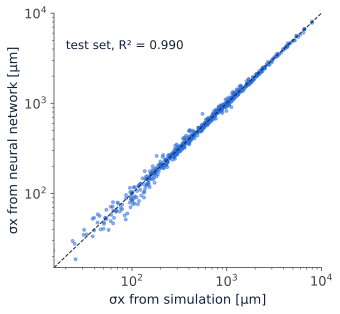{height="400px"}
:::
::: {.column width="60%"}
**Parity plot**: each point is one test setting. On the diagonal = perfect prediction.

::: {.box .small}
Network 3 → 64 → 64 → 64 → 2 trained on 2400 simulations of the exercise beamline;
it predicts **log σ** (beam sizes span 3 orders of magnitude).
:::
::: {.box-red .small .fragment}
<span class="box-title">Pitfalls (you will test them)</span>
too few training samples; settings **outside** the training range (extrapolation);
the machine is not the simulation (errors, drifts).
:::
::: {.box-teal .small .fragment}
<span class="box-title">In the literature</span>
LCLS / FACET-II longitudinal phase-space virtual diagnostic (Emma *et al.* 2018);
surrogate-based multi-objective optimisation, orders of magnitude faster (Edelen *et al.* 2020).
:::
:::
::::

::: {.ref}
Emma *et al.*, PRAB **21**, 112802 (2018) · Edelen *et al.*, PRAB **23**, 044601 (2020).
:::

::: notes
This is how you judge a surrogate: a parity plot. Each point is one test setting, never seen in
training. Horizontally the simulated beam size, vertically the prediction. Perfect predictions
lie on the diagonal. This network was trained on 2400 simulations; note that it predicts the
logarithm of the beam size, because beam sizes span three orders of magnitude — choosing a good
representation of the data matters as much as the model.

[click] The pitfalls, which you will test yourself: too few training samples; settings outside
the training range, where the network extrapolates silently; and the gap between simulation and
the real machine.

[click] In the literature: a virtual diagnostic of the longitudinal phase space developed for
LCLS and FACET-II, and surrogate models that made multi-objective optimisation of an injector
orders of magnitude faster.
:::

## 2 · Bayesian optimisation: the setting

:::: {.columns}
::: {.column width="52%"}
Tuning **on the real machine**:

::: {.incremental}
- no formula and **no gradient**
- every measurement is **noisy**
- every measurement costs **beam time** ⇒ we can afford ~10–100 trials, not 10 000
:::

::: {.box-orange .fragment}
<span class="box-title">How would a careful operator do it?</span>
Remember every trial so far, build a mental picture of the landscape, and choose the next trial
either where it looks **good**, or where they **know too little**.
:::
:::
::: {.column width="48%"}
::: {.box-teal .fragment}
<span class="box-title">Bayesian optimisation does exactly that</span>

1. a **surrogate with uncertainty** of the objective, rebuilt after every measurement:
   the *Gaussian process*
2. a rule to pick the next trial, balancing "good" and "unknown":
   the *acquisition function*
3. measure, add the point, repeat
:::
:::
::::

::: notes
Second method: Bayesian optimisation, now a standard tool in control rooms.

The setting is tuning on the real machine. [click] There is no formula, so no gradient.
[click] Every measurement is noisy. [click] And every measurement costs beam time: we can afford
ten to a hundred trials, not ten thousand.

[click] How would a careful operator proceed? They remember all the trials so far, build a
mental picture of the landscape, and choose the next trial either where it looks good, or where
they know too little to be sure.

[click] Bayesian optimisation formalises exactly this. A surrogate model that also gives an
uncertainty — the Gaussian process — rebuilt after every measurement. A rule to choose the next
trial, balancing "promising" and "unknown" — the acquisition function. Then measure, add the
point, and repeat.
:::

## The Gaussian process: a fit that knows what it does not know

::: {.r-stack}
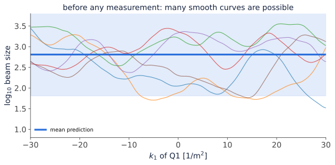{height="330px" fig-align="center"}

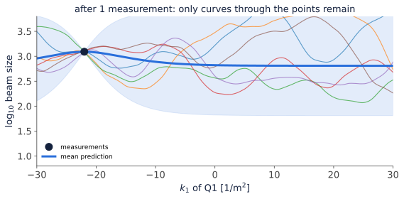{.fragment height="330px" fig-align="center"}

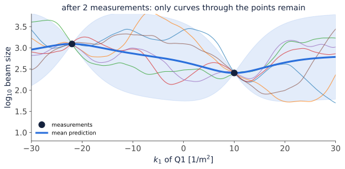{.fragment height="330px" fig-align="center"}

{.fragment height="330px" fig-align="center"}
:::

:::: {.columns}
::: {.column width="50%"}
::: {.box .small}
A GP considers **all smooth curves** compatible with the data. Where measurements are close,
curves agree: low uncertainty. Far from measurements, they disagree: high uncertainty.
:::
:::
::: {.column width="50%"}
::: {.box-orange .small}
<span class="box-title">The kernel</span>
encodes "nearby settings give similar beams" — with a **length scale**: how far apart two
settings can be and still be similar. It is learned from the data.
:::
:::
::::

::: notes
What is a Gaussian process? Think of it as a fit that knows what it does not know.

Before any measurement, the GP considers many possible smooth curves — the thin coloured lines.
Their average is the prediction, in thick blue; their spread, the shaded band, is the
uncertainty. Here it is large everywhere: we know nothing yet.

[click] After one measurement, only curves passing through that point remain plausible. The
uncertainty collapses near the point and stays large far away. [click] After two
measurements. [click] After four, the shape of the function starts to be known between the
points, and uncertain only where we have not measured.

What defines "smooth"? The kernel. It encodes the prior belief that nearby settings give similar
beams, with a length scale: how far apart two settings can be and still be similar. The length
scale is learned from the data. This mean-plus-uncertainty is exactly what Bayesian
optimisation needs.
:::

## Bayesian optimisation in action

::: {.r-stack}
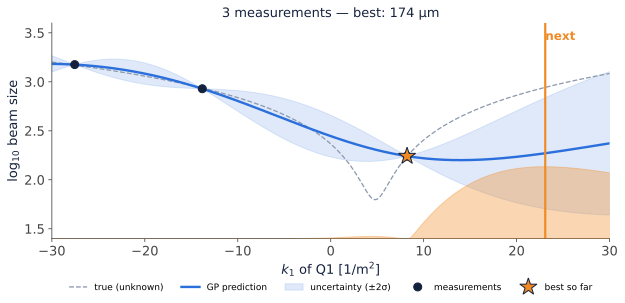{height="360px" fig-align="center"}

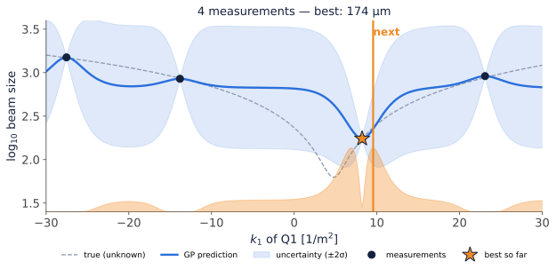{.fragment height="360px" fig-align="center"}

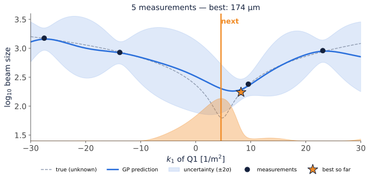{.fragment height="360px" fig-align="center"}

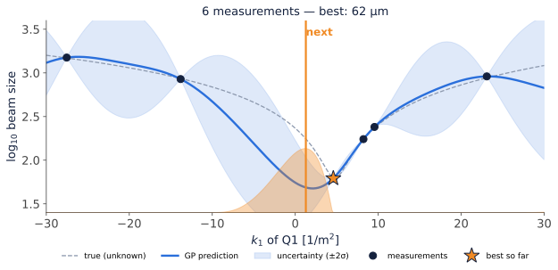{.fragment height="360px" fig-align="center"}

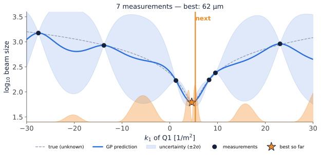{.fragment height="360px" fig-align="center"}

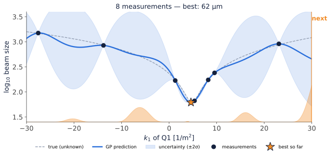{.fragment height="360px" fig-align="center"}

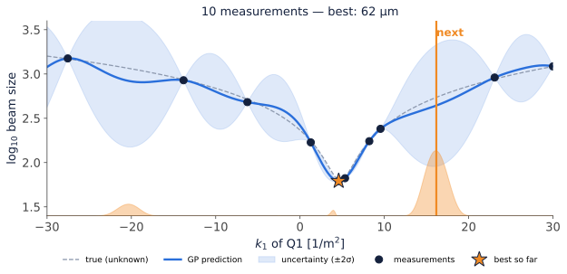{.fragment height="360px" fig-align="center"}
:::

:::: {.columns}
::: {.column width="55%"}
::: {.box .small}
**Expected improvement** (orange area): how much a new trial at $x$ is expected to beat the best
value so far. Large where the prediction is **low** (*exploit*) **or** the uncertainty is
**large** (*explore*). The next trial is at its maximum.
:::
:::
::: {.column width="45%"}
::: {.box-teal .small}
**Use BO when:** each evaluation is expensive and noisy, no gradients, ≲ 20 knobs.
:::
:::
::::

::: {.ref}
Duris *et al.*, PRL **124**, 124801 (2020) — BO of the LCLS FEL ·
Roussel *et al.*, PRAB **27**, 084801 (2024) — review · [Xopt](https://github.com/xopt-org/Xopt).
:::

::: notes
Let us run Bayesian optimisation on our beamline: we tune Q1 to minimise the beam size, with
the other quadrupoles fixed. The dashed grey line is the true function — unknown to the
algorithm.

We start with 3 random measurements. The GP prediction is in blue, with its uncertainty band.
The orange area at the bottom is the expected improvement: how much we can hope to beat the
best value so far by measuring at each point. It is large where the prediction is low —
exploitation — or where the uncertainty is large — exploration. The next measurement is at the
maximum, the orange line. Here it goes to the right, where we know nothing.

[click] 4 measurements: nothing good on the right; the uncertainty there collapses.
[click] Now it explores near the current best. [click] [click] It finds the narrow valley.
[click] Now the best value is 62 µm, close to the true minimum. [click] After 10 measurements,
the minimum is well known, and the expected improvement is small everywhere: it starts to
explore far away, just in case.

Ten measurements to find the minimum of a noisy function, without gradients. This is why BO is
popular for online tuning: for example at LCLS, to maximise the free-electron-laser pulse
energy. Use it when evaluations are expensive and noisy, with up to about twenty knobs. In
practice, use a library such as Xopt. You will code this loop yourself in exercise 2.
:::

## 3 · Anomaly detection: learn what "normal" looks like

:::: {.columns}
::: {.column width="45%"}
::: {.r-stack}
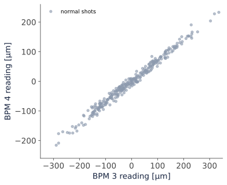{width="100%"}

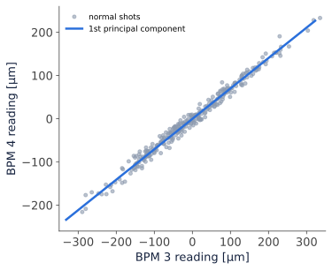{.fragment fragment-index="1" width="100%"}

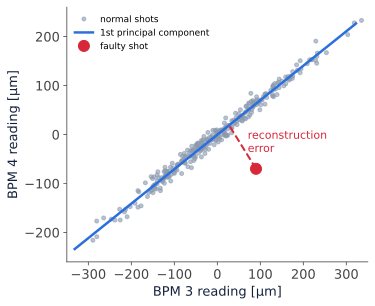{.fragment fragment-index="2" width="100%"}
:::
:::
::: {.column width="55%"}
Two neighbouring BPMs see the **same** orbit jitter: their readings are strongly correlated.
Normal shots lie close to a line.

::: {.box .small .fragment fragment-index="1"}
<span class="box-title">PCA (principal component analysis)</span>
finds that line (in general: the few directions in which the data vary most) **from the data
alone**, without any optics model.
:::
::: {.box-red .small .fragment fragment-index="2"}
<span class="box-title">Anomaly score</span>
the distance of a shot to the line (**reconstruction error**). The faulty reading is not large —
it is **inconsistent** with the other BPM.
:::
::: {.box-teal .small .fragment fragment-index="3"}
No labels needed: this is **unsupervised** learning.
:::
:::
::::

::: notes
Third method: anomaly detection. Here is the problem: beam position monitors sometimes misbehave
— an offset, a dead channel, extra noise — and nobody labels these faults in the archived data.

Each grey point is one shot, the readings of two neighbouring BPMs. Since both see the same
orbit jitter, their readings are strongly correlated: normal shots lie close to a line.

[click] Principal component analysis finds this line from the data alone, without any optics
model. In general, it finds the few directions in which the data vary most.

[click] Now a faulty shot, in red. Its readings are not particularly large — each one alone is
within the normal range. But the pair is inconsistent: it is far from the line. The distance to
the line, called the reconstruction error, is our anomaly score.

[click] No labels were needed: this is unsupervised learning. With ten BPMs and two steering
magnets, normal orbits live on a two-dimensional plane in a ten-dimensional space, and PCA
finds this plane. That is exactly exercise 3.
:::

## Another detector: the Isolation Forest

{height="330px" fig-align="center"}

::: {.box .small .fragment}
Cut the data with **random** vertical/horizontal lines until the point is alone.
Anomalies are "few and different": they are isolated after **few** cuts. Repeat with many random
"trees" and average: the average number of cuts is the anomaly score. No assumption of linearity needed.
:::

::: notes
A second detector, the Isolation Forest, is based on a simple idea. Take the data and cut it
with random vertical or horizontal lines, until the point you are interested in is alone in its
box.

On the left, an anomaly far from the cloud: it is isolated after about four random cuts on
average. On the right, a normal point in the middle of the cloud: it takes about twelve cuts.

[click] Anomalies are "few and different", so they are isolated quickly. We repeat this with many
random trees — hence "forest" — and the average number of cuts gives the anomaly score. Unlike
PCA, it makes no assumption of linearity. It has been used, for example, to detect faulty BPMs
at the LHC.
:::

## Anomaly detection & fault classification in practice

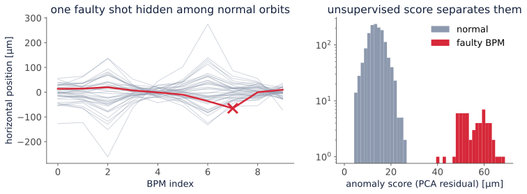{height="290px" fig-align="center"}

:::: {.columns}
::: {.column width="50%"}
::: {.box-teal .small .fragment}
<span class="box-title">Unsupervised — no labels</span>
Faulty BPMs at the LHC detected with an Isolation Forest.
:::
:::
::: {.column width="50%"}
::: {.box .small .fragment}
<span class="box-title">Supervised — with labels</span>
Once experts have labelled past events: classify fault types, e.g. SRF cavity trips at CEBAF from RF waveforms.
:::
:::
::::

::: {.ref}
Fol *et al.*, PRAB **23**, 102805 (2020) — faulty BPM detection (LHC) ·
Tennant *et al.*, PRAB **23**, 114601 (2020) — SRF cavity fault classification (CEBAF).
:::

::: notes
On the left, one faulty shot, in red, hidden among 40 normal orbits along ten BPMs. By eye, it
is almost impossible to see. On the right, the PCA anomaly score of 1500 shots: the faulty ones,
in red, clearly separate from the normal ones.

[click] Without labels, this is the unsupervised approach, used for example at the LHC with an
Isolation Forest.

[click] When experts have labelled past events, we can go further with supervised
classification: for example, at CEBAF, the type of superconducting cavity fault is identified
automatically from the RF waveforms recorded at the trip.
:::

## 4 · Reinforcement learning: the vocabulary

:::: {.columns}
::: {.column width="52%"}
{width="100%"}
:::
::: {.column width="48%"}
Example: focus the beam on a screen.

::: {.incremental style="font-size:0.8em"}
- **State / observation**: what the agent sees — the beam image, current magnet settings
- **Action**: what it can do — change the magnet strengths a little
- **Reward**: a number saying how good the result is — e.g. minus the beam size
- **Policy**: the agent's strategy, observation → action — usually a neural network
- **Episode**: one attempt, from a random start until the beam is focused (or time is up)
:::
:::
::::

::: notes
Fourth method: reinforcement learning, the most ambitious one. An agent interacts with an
environment — here the accelerator, or a simulation of it — in a loop.

Let me define the vocabulary with the example of focusing the beam on a screen.
[click] The observation: what the agent sees, for example the beam image and the current magnet
settings. [click] The action: what it can do, here change the magnet strengths a little.
[click] The reward: a number that says how good the result is, for example minus the beam size.
[click] The policy: the strategy of the agent, a function from observation to action, usually a
neural network. [click] And an episode: one attempt, from a random starting point until the
beam is focused or the time is up.

The big difference with supervised learning: nobody tells the agent what the right action is.
It only receives a reward after acting, and must discover good actions by itself.
:::

## Reinforcement learning: how the agent learns

:::: {.columns}
::: {.column width="55%"}
::: {.incremental}
1. start with a **random** policy: actions are nonsense
2. play many episodes; record (observation, action, reward)
3. adjust the policy network so that actions leading to **high total reward** become more likely
4. repeat — typically **10⁴–10⁶ episodes**
:::

::: {.box-orange .small .fragment}
<span class="box-title">Where do we find a million episodes?</span>
Not on the machine! Train in a **fast simulator** (e.g. Cheetah), with randomised errors so the
agent becomes robust, then deploy on the real machine (*sim-to-real transfer*).
:::
:::
::: {.column width="45%"}
::: {.box-teal .small .fragment}
<span class="box-title">Strengths</span>
Once trained, acts in a few steps; can react to changing conditions (feedback).
:::
::: {.box-red .small .fragment}
<span class="box-title">Costs</span>
Long training, careful reward design, gap between simulation and reality.
:::
::: {.box .small .fragment}
<span class="box-title">RL or BO?</span>
Compared on the same real tuning task at ARES (DESY): RL fast once trained, BO ready
out of the box with no training.
:::
:::
::::

::: {.ref}
Kain *et al.*, PRAB **23**, 124801 (2020) — sample-efficient RL at CERN (AWAKE) ·
Kaiser *et al.*, Sci. Rep. **14**, 15733 (2024) — RL-trained optimisers vs BO at ARES.
:::

::: notes
How does the agent learn? [click] It starts with a random policy: its actions are nonsense.
[click] It plays many episodes and records what it saw, what it did, and what reward it got.
[click] Then the policy network is adjusted so that actions that led to a high total reward
become more likely. [click] And we repeat — typically tens of thousands to millions of episodes.

[click] Where do we find a million episodes? Certainly not on the real machine! The agent is
trained in a fast simulator — this is one reason why codes like Cheetah were developed — with
randomised errors so that it becomes robust, and then deployed on the machine. This is called
sim-to-real transfer.

[click] Strengths: once trained, the agent acts in a few steps and can react to changing
conditions. [click] Costs: long training, careful design of the reward, and the gap between
simulation and reality. [click] At DESY, both approaches were compared on the same real tuning
task: the RL agent was faster once trained, while Bayesian optimisation worked out of the box
without any training. Earlier, at CERN, sample-efficient RL was demonstrated for trajectory
steering at AWAKE.
:::

## 5 · Differentiable simulations

:::: {.columns}
::: {.column width="52%"}
A beamline is a chain of elements; the beam at the screen is a **composition** of functions:
$$
\sigma_\text{screen} = f_\text{drift}\big(f_{Q3}\big(\dots f_{Q1}(\text{beam}_0;\,k_1)\dots\big)\big)
$$
The **chain rule** gives $\partial\sigma/\partial k_1$ by multiplying the derivatives of each element.

::: {.box-teal .small .fragment}
Write the simulator in an ML framework (PyTorch) ⇒ it does this **automatically**, exactly as
backpropagation in a neural network.
:::
:::
::: {.column width="48%"}
::: {.box .small .fragment}
<span class="box-title">What gradients give you</span>

- tune many magnets at once by gradient descent
- fit a model to measurements (*system identification*)
- train RL agents and neural components fast
:::
::: {.box-orange .small .fragment}
<span class="box-title">Physics-informed ML</span>
Put physics **into** the model (conservation laws, symplecticity…): less data, better
extrapolation. The trend: **hybrid** physics + ML models.
:::
:::
::::

::: {.fragment}
```python
segment.Q1.k1 = torch.nn.Parameter(torch.tensor(5.0))   # make k1 trainable
loss = segment.track(beam).sigma_x                       # simulate
loss.backward()                                          # d(sigma_x)/d(k1), automatically
```
:::

::: {.ref}
Kaiser *et al.*, PRAB **27**, 054601 (2024) — Cheetah, [github.com/desy-ml/cheetah](https://github.com/desy-ml/cheetah).
:::

::: notes
Fifth and last family: differentiable simulations — where machine learning tools come back to
help physics.

A beamline is a chain of elements, so the beam at the screen is a composition of functions:
the drift applied to the quadrupole applied to the drift, and so on. The chain rule gives the
derivative of the beam size with respect to any magnet strength by multiplying the derivatives
of each element — exactly like backpropagation in a neural network.

[click] If the simulator is written in an ML framework like PyTorch, these derivatives are
computed automatically. This is what Cheetah does.

[click] What do gradients give you? Tuning many magnets at once by gradient descent; fitting a
model of the machine to measurements; training RL agents and neural network components much
faster.

[click] A related trend is physics-informed machine learning: putting physics into the model —
conservation laws, symplectic structure — so that it needs less data and extrapolates better.
The future is hybrid models: physics where we know it, learning where we don't.

[click] In code, three lines: declare k1 as trainable, simulate, and call backward. You will do
this in exercise 0.
:::

## Which method when?

| Method | Learns from | Needs | Typical use | Exercise |
|:--|:--|:--|:--|:--:|
| **Neural-net surrogate** | (input, output) examples | 10³–10⁶ samples, mostly simulation | fast models, virtual diagnostics | 1 |
| **Gaussian process / BO** | each new measurement | 10–100 evaluations, ≲ 20 knobs | online tuning, noisy & expensive | 2 |
| **PCA / Isolation Forest** | unlabelled data | "mostly normal" data | faulty sensors, unusual states | 3 |
| **Classifier** (random forest, NN) | labelled events | expert labels | fault type identification | — |
| **Reinforcement learning** | interaction & reward | 10⁴–10⁶ episodes (simulator) | fast tuning, feedback control | — |
| **Differentiable simulation** | physics model + gradients | a differentiable model | many-knob tuning, model calibration | 0 |

::: {.box-orange .small .fragment}
**Rule of thumb:** start with the simplest method that could work (a linear fit, a threshold,
a grid scan) — it is your **baseline**. An ML method must beat it to be worth deploying.
:::

::: notes
Here is the summary of the tour, as a decision table. The key column is "Needs": the right
method depends first on how much data you can get and how expensive each data point is.

Thousands of cheap simulations: a neural-network surrogate. Ten to a hundred expensive, noisy
measurements: Gaussian processes and Bayesian optimisation. Archived data without labels:
PCA or Isolation Forest. Labelled events: a classifier. A fast simulator and the need for
real-time control: reinforcement learning. A differentiable model of the machine: gradients.

[click] And always the same rule of thumb: start with the simplest method that could work. It
is your baseline, and an ML method must beat it to be worth deploying.
:::

# Good practice {background-color="#14213d" .section-slide}

## What goes wrong in practice

::: {.cards-2}
::: {.box .fragment}
<span class="box-title">🔍 Look at the data first</span>
Units, ranges, missing values, saturations, timestamps. Choose a good representation (e.g. log of beam size).
:::
::: {.box-orange .fragment}
<span class="box-title">📏 Honest evaluation</span>
Separate test set, from another run or day. Compare with a simple baseline.
:::
::: {.box-teal .fragment}
<span class="box-title">❓ Know what the model does not know</span>
Training domain, extrapolation, **uncertainty** (GPs, ensembles). Drifts ⇒ retrain.
:::
::: {.box-red .fragment}
<span class="box-title">🛡️ Safety in the control room</span>
Hard limits on actuators, slow ramps, operator in the loop, a "go back" button.
:::
:::

::: {.small .center .fragment}
**Toolbox:** scikit-learn (classical ML) · PyTorch (neural nets) · Cheetah (differentiable beam dynamics) ·
Xopt / BoTorch (BO) · Gymnasium + Stable-Baselines3 (RL)
:::

::: notes
Most machine-learning projects that fail do not fail because of the algorithm. They fail on
data, evaluation, or deployment. Four rules.

[click] Look at the data first: units, ranges, missing values, saturated sensors, timestamps.
And choose a good representation — remember the logarithm of the beam size.

[click] Evaluate honestly: a separate test set, ideally from another run or another day, and
always a comparison with a simple baseline.

[click] Know what the model does not know: its training domain, the risk of extrapolation, and
its uncertainty. Gaussian processes and ensembles of networks give uncertainties. When the
machine drifts, retrain.

[click] And safety: in a control room, an algorithm acts on real hardware. Hard limits on
actuators, slow ramps, an operator in the loop, and a button to go back to the previous settings.

[click] The toolbox: scikit-learn for classical ML, PyTorch for neural networks, Cheetah for
differentiable beam dynamics, Xopt or BoTorch for Bayesian optimisation, Gymnasium and
Stable-Baselines3 for reinforcement learning.
:::

## Take-home messages

::: {.cards-3}
::: {.box .fragment}
<span class="icon">1</span>
ML = **fitting flexible models to data**: data, model, loss, optimiser.
A neural network is a sum of many simple "hinges" whose shape is learned by gradient descent.
:::
::: {.box-orange .fragment}
<span class="icon">2</span>
Pick the method from the **task** and the **data you have**:
surrogate, BO, anomaly detection, RL, differentiable simulation.
:::
::: {.box-teal .fragment}
<span class="icon">3</span>
**Physics + ML** beats either alone. Start simple, keep a test set, know the limits.
:::
:::

::: notes
Three messages to take home.

[click] One: machine learning is fitting flexible models to data — data, model, loss, optimiser.
A neural network is nothing more than a sum of many simple hinges whose shape is learned by
gradient descent.

[click] Two: choose the method from the task and from the data you have — surrogate, Bayesian
optimisation, anomaly detection, reinforcement learning, or differentiable simulation.

[click] Three: physics plus machine learning beats either alone. Start simple, keep a test set,
and know the limits of your model.
:::

## Check your understanding

::: {.cards-2}
::: {.box}
**Q1.** You have 30 measurements, each costing 5 min of beam time, to tune 4 magnets. Which method?
<br><span class="fragment blue">→ Bayesian optimisation: few, expensive, noisy evaluations.</span>
:::
::: {.box-orange}
**Q2.** Your network has a training error of zero. Is it a good model?
<br><span class="fragment blue">→ Not necessarily: check it on a test set — it may be overfitting.</span>
:::
::: {.box-teal}
**Q3.** Why does a neural network need activation functions?
<br><span class="fragment blue">→ Without them it is linear: stacking linear layers gives a straight line.</span>
:::
::: {.box-navy}
**Q4.** A BPM reads 0.2 mm, well within its usual range. Can it still be faulty?
<br><span class="fragment blue">→ Yes: what matters is the consistency with the other BPMs (PCA residual).</span>
:::
:::

::: notes
Before the exercises, four quick questions. Give the audience thirty seconds for each, ask for
a show of hands, then reveal the answer.

Q1: 30 measurements, 5 minutes each, 4 magnets. [click] Bayesian optimisation: few, expensive,
noisy evaluations, no gradient. A neural-network surrogate would need far more data.

Q2: a training error of exactly zero. [click] Not necessarily good: it may have memorised the
noise. Only the error on a test set tells you.

Q3: why activation functions? [click] Without them, the network is a composition of linear
functions, so it is linear: a straight line, whatever its size.

Q4: a BPM reading within its usual range. [click] It can still be faulty: what matters is
whether the reading is consistent with the others — the PCA reconstruction error.
:::

## Your turn: the exercises

All notebooks run in the browser on Google Colab (free Google account) — click, then *Runtime → Run all*.

| # | Notebook | Method | |
|:-:|:--|:--|:--:|
| 0 | First beamline with Cheetah | tracking, manual & gradient-based tuning | [](https://colab.research.google.com/github/hayg25/ML4Accelerators/blob/main/notebooks/00_cheetah_basics.ipynb) |
| 1 | Neural-network surrogate | supervised regression | [](https://colab.research.google.com/github/hayg25/ML4Accelerators/blob/main/notebooks/01_surrogate_model.ipynb) |
| 2 | Bayesian optimisation | GP + acquisition function | [](https://colab.research.google.com/github/hayg25/ML4Accelerators/blob/main/notebooks/02_bayesian_optimisation.ipynb) |
| 3 | Faulty BPM detection | unsupervised anomaly detection | [](https://colab.research.google.com/github/hayg25/ML4Accelerators/blob/main/notebooks/03_anomaly_detection.ipynb) |

::: {.box-orange .small .fragment}
Cells marked ✏️ are for you. Solutions, lecture notes and all links:
**[hayg25.github.io/ML4Accelerators](https://hayg25.github.io/ML4Accelerators/)**.
🔒 A second set of exercises, on **nuclear-energy** applications, will be unlocked during the workshop.
:::

::: notes
Now it is your turn. Four notebooks, all on the same beamline, all running in your browser on
Google Colab. Exercise 0 is an introduction to Cheetah and to gradient-based tuning; exercise 1
builds a neural-network surrogate; exercise 2 codes Bayesian optimisation; exercise 3 detects
faulty BPMs.

[click] The cells marked with a pencil are for you; solutions are available on the website,
together with written lecture notes that follow these slides. And a second set of exercises,
applying the same methods to nuclear-energy problems — gamma spectroscopy, a reactor-physics
surrogate, neutron/gamma discrimination — will be unlocked later in the workshop.
:::

## To go further

::: {.cards-2}
::: {.box}
<span class="box-title">🎬 Start here</span>

- [3Blue1Brown — Neural networks](https://www.3blue1brown.com/topics/neural-networks) (videos)
- [Inria — ML in Python with scikit-learn](https://www.fun-mooc.fr/en/courses/machine-learning-python-scikit-learn/) (MOOC)
- [Google — ML Crash Course](https://developers.google.com/machine-learning/crash-course)
:::
::: {.box-teal}
<span class="box-title">📚 Go deeper</span>

- [Dive into Deep Learning](https://d2l.ai) (free book with code)
- [A Visual Exploration of Gaussian Processes](https://distill.pub/2019/visual-exploration-gaussian-processes/)
- [Garnett — Bayesian Optimization](https://bayesoptbook.com) (free book)
:::
::: {.box-orange}
<span class="box-title">⚛️ Accelerators</span>

- [Cheetah](https://github.com/desy-ml/cheetah) · [Xopt](https://github.com/xopt-org/Xopt)
- [RL4AA tutorial on ARES](https://rl4aa.github.io/rl-tutorial-ares-basic/slides.html)
- Edelen *et al.*, arXiv:1811.03172 · Roussel *et al.*, PRAB **27**, 084801
:::
::: {.box-navy}
<span class="box-title">🌐 Full list</span>

All links, reviews and the papers cited today:
**[hayg25.github.io/ML4Accelerators/resources.html](https://hayg25.github.io/ML4Accelerators/resources.html)**
:::
:::

::: notes
If you want to go further, here are a few starting points. To start: the 3Blue1Brown videos on
neural networks are the best visual introduction I know; the free scikit-learn MOOC from Inria
is excellent for hands-on classical machine learning; Google's crash course is short and
practical.

To go deeper: the free book "Dive into Deep Learning", with code; the interactive Distill
article on Gaussian processes; and Roman Garnett's book on Bayesian optimisation, also free.

For accelerators: Cheetah and Xopt, the reinforcement-learning tutorial of the RL4AA community
on the ARES accelerator, and two reviews. The complete list, with all the papers cited today, is
on the course website.
:::

## Questions? {background-color="#14213d" .section-slide}

<br>

::: {style="color: white; font-size: 0.8em;"}
Slides, lecture notes & exercises: [hayg25.github.io/ML4Accelerators](https://hayg25.github.io/ML4Accelerators/){style="color:#f08a24"}
<br>Source: [github.com/hayg25/ML4Accelerators](https://github.com/hayg25/ML4Accelerators){style="color:#f08a24"}
:::

::: notes
Thank you. I am happy to take questions. A list of likely questions with suggested answers is in
the lecture notes on the website.
:::

## Backup — glossary

| Term | Meaning |
|:--|:--|
| **Sample / input / target** | one example; the quantity we know; the quantity to predict |
| **Model, parameters** | function with adjustable numbers (weights) mapping inputs to outputs |
| **Loss** | number measuring how wrong the model is; training minimises it |
| **Gradient descent, learning rate** | walk downhill on the loss; size of each step |
| **Neuron, activation** | weighted sum + bias, followed by a non-linear function (ReLU…) |
| **Backpropagation** | chain rule computing the gradient of the loss for every weight |
| **Epoch** | one pass over the whole training set |
| **Overfitting** | model learns the noise of the training data; poor on new data |
| **Gaussian process, kernel** | regression giving a mean and an uncertainty; kernel = notion of similarity |
| **Acquisition function** | rule deciding where Bayesian optimisation measures next |
| **PCA** | finds the few directions in which the data vary most |
| **Policy, reward, episode** | RL: strategy observation → action; score of an action; one attempt |
| **Differentiable simulation** | simulator that also returns gradients of its outputs |

::: notes
Backup slide: a glossary of the terms used in the lecture.
:::
